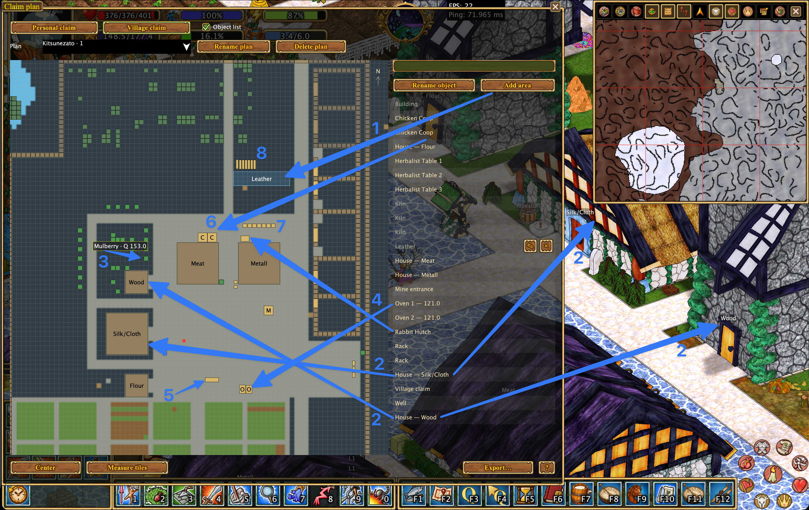
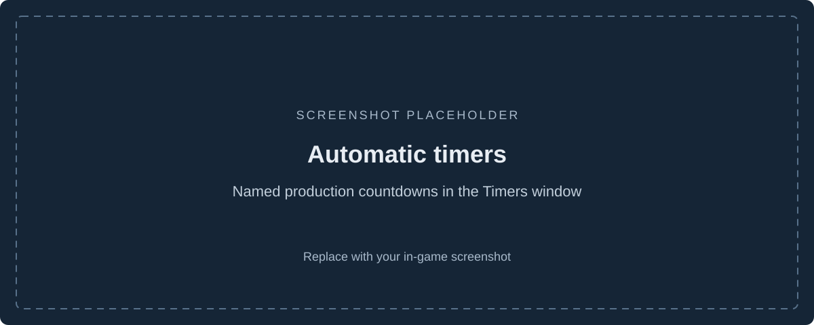
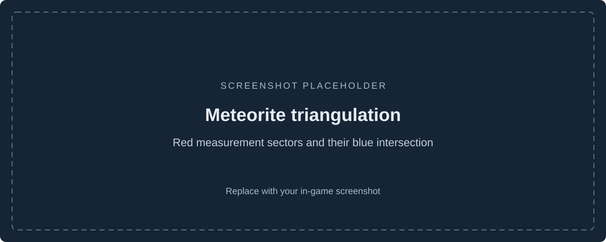
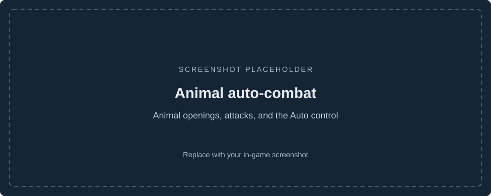
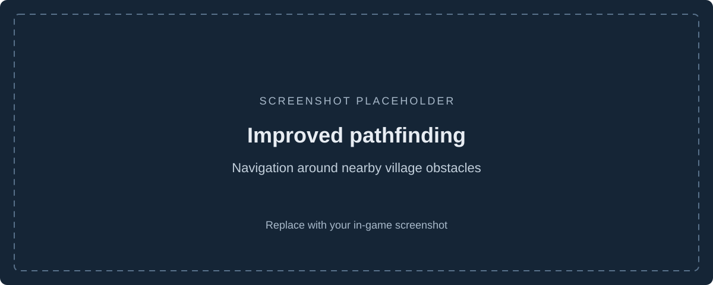
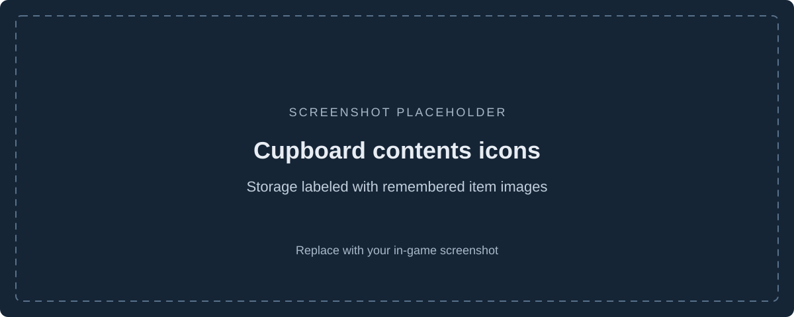
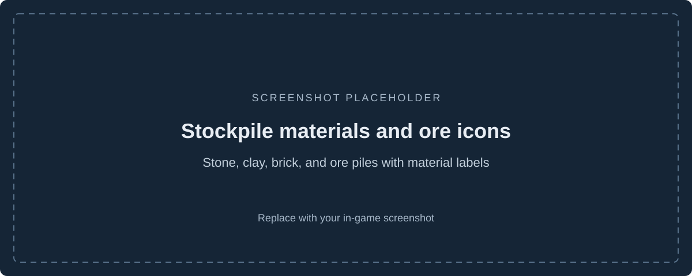
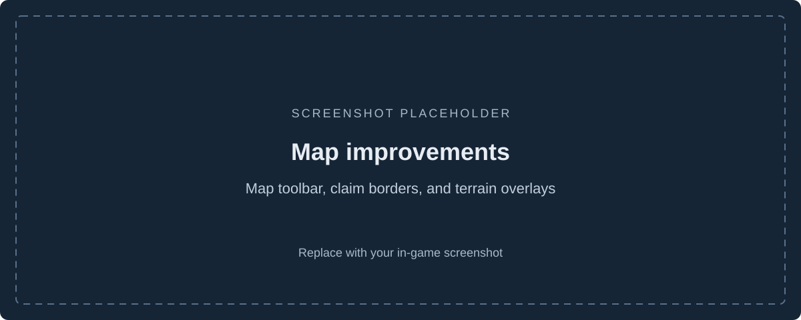
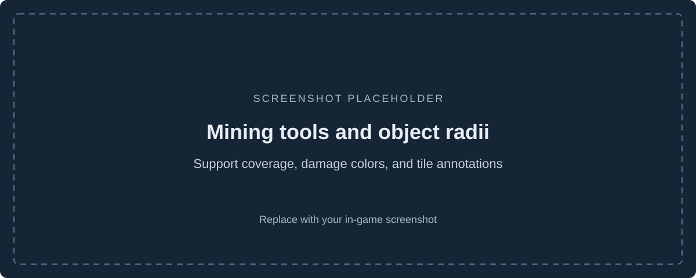
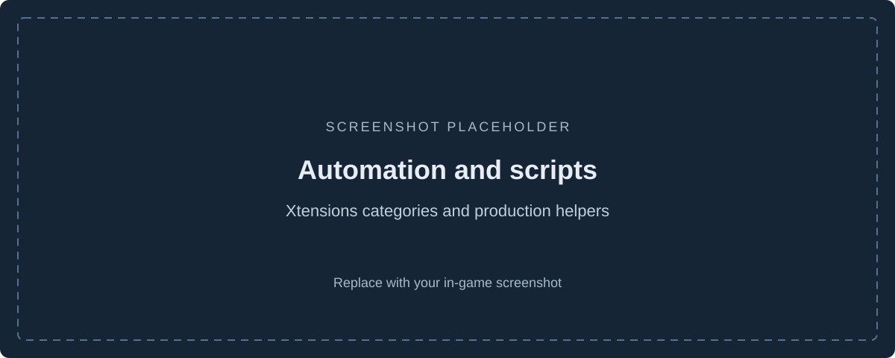

# Hearthborn

**A custom Haven & Hearth client for village management, production, exploration, and everyday play.**

Hearthborn brings village plans, cheese production tools, automatic timers, meteorite triangulation, and practical automation into one client. It also improves navigation, storage labels, mining overlays, and the interface, with English and Russian language support.


## Explore the features

- [Village and claim plans](#village-and-claim-plans)
- [Cheese production assistant](#cheese-production-assistant)
- [Automatic timers](#automatic-timers)
- [Meteorite triangulation and starfall tracking](#meteorite-triangulation-and-starfall-tracking)
- [Animal auto-combat — stage 1](#animal-auto-combat--stage-1)
- [Improved pathfinding](#improved-pathfinding)
- [Automatic cupboard contents icons](#automatic-cupboard-contents-icons)
- [Stockpile materials and ore icons](#stockpile-materials-and-ore-icons)
- [Map improvements](#map-improvements)
- [Mining tools and object radii](#mining-tools-and-object-radii)
- [Automation and useful scripts](#automation-and-useful-scripts)
- [Everyday interface improvements](#everyday-interface-improvements)
- [Build and documentation](#build-and-documentation)

## Village and claim plans

Keep a local overview of your village and personal claims, including terrain, buildings, production objects, and saved observations from previous visits.

- Browse objects in a searchable list and select one to center the plan on it.
- Rename supported objects and mark named areas of the settlement.
- Measure rectangular areas in tiles when planning construction or fields.
- View saved objects on different levels and return to the character's current level.
- Save and rename plans, export them to HTML or Excel, and import or export plan files for sharing.

The plan fills in as you explore. It uses loaded claim data and saved observations; it cannot reveal unexplored areas or automatically confirm every claim permission.



[Read more about claim plans](docs/features/claim-plan.en.md).

## Cheese production assistant

Follow cheese from curd to its next aging stage without keeping a separate reference open.

- Browse cheese progression charts for cow, sheep, and goat milk.
- See tray contents, aging stages, readiness, and the expected next product in an open rack.
- Use aging-location information to understand the next transformation.
- Track observed aging processes in the dedicated **Cheese** tab of the Timers window.
- Show cheese rack labels in the world and fill empty trays with the tray-filling helper.

The helper's location selector changes its predictions and tooltips. Moving the cheese to the correct location in the game is still required.


## Automatic timers

Bring production countdowns and personal reminders together in one window, with separate **Automatic**, **Cheese**, and **Manual** tabs.

| Process | What the client tracks |
| --- | --- |
| Ore smelters, stack furnaces, kilns, and finery forges | Supported processing progress observed in the object's window. |
| Steel crucibles | Observed fuel supply, as a fuel countdown. |
| Cheese racks | Aging estimates based on observed cheese and its location. |
| Herbalist tables and silk production | Supported seedling, egg, and cocoon progress. |
| Battering rams and wrecking balls | Preparation time reported by the server after interaction. |
| Personal claims | Activation wait after placement, refined by supported server messages. |
| Starfall | The server's upper estimate after a successful Star Gaze cast. |

Name and sort timers, show countdowns above supported objects, and click an associated timer row to highlight a loaded object. Manual timers can be paused, resumed, and deleted. Running countdowns keep their deadlines across client restarts.

Automatic timers depend on received information, usually from opening the object's window. They are estimates of the last observed state; changes outside the client's view can make them outdated.



[Read more about timers and supported processes](docs/features/timers.en.md).

## Meteorite triangulation and starfall tracking

Turn Star Gaze directions into a map-based search for the meteorite.

1. Cast **Star Gaze** manually at night.
2. The client saves the casting position and the server's direction sector.
3. Move sideways and cast again from another location.
4. Compare the red sectors and their shared area, highlighted in blue, on the large or detached map.

Red measurement points have visible numbers. Measurements survive reconnects and remain after the forecast expires, so you can keep searching after the expected fall. Right-click a measurement point, its number, or the triangulation label to clear all measurements while keeping the forecast timer. A newly observed starfall starts a fresh set of measurements.

While Star Gaze is available, the first status icon announces the event and displays the saved forecast with explicit hours and minutes. A successful cast also adds the forecast to Timers. Three golden shooting stars animate inside the calendar at night during the event.

Triangulation narrows an **estimated search area**. The server supplies direction boundaries, without a distance or an exact impact point. The countdown is an upper estimate, not confirmation that a meteorite has landed.



[Read more about starfall and triangulation](docs/features/timers.en.md#meteorite-triangulation).

## Animal auto-combat — stage 1

The first stage of auto-combat helps choose attacks during an existing fight with an animal.

- Selects supported attacks from the active deck to match the animal's openings.
- Accounts for attack cooldowns and initiative requirements.
- Provides an **Auto: on / Auto: off** control in the combat interface.
- Works alongside combat displays for openings, damage, target highlighting, health, and stamina.

This stage automates attack selection against animals. It does not attack player characters or provide a complete hunting routine; you still manage engagement, positioning, and survival.



## Improved pathfinding

Walk around nearby loaded obstacles when clicking the ground or approaching supported stationary objects.

- With **Automatic pathfinding** enabled, ordinary clicks use routing and **Ctrl-click** moves directly.
- With the option disabled, **Ctrl-click** requests routing instead.
- Cancel the route with **Escape**, manual movement keys, or a new movement command.

Pathfinding is local and unavailable during combat. It depends on loaded terrain and collision data, so it cannot plan a journey across unexplored parts of the world.



## Automatic cupboard contents icons

Recognize storage at a glance using item images displayed above cupboards.

- Let the client choose an icon from observed cupboard contents.
- Pick a specific item as the cupboard's icon when you want a custom label.
- Choose whether icons are always visible, shown while holding **Space**, or hidden.
- Keep remembered icons across reconnects using locally saved observations.

Icons are based on contents the client has seen. They do not reveal the inventory of an unopened, unknown cupboard.



## Stockpile materials and ore icons

Tell materials apart in the world instead of opening every pile.

- **Stone, clay, and brick:** piles use the corresponding loose item's material appearance while preserving the pile shape and lighting.
- **Metal bars:** piles use the remembered metal material.
- **Ore:** piles keep their original appearance and show an ore inventory icon above them.
- **Stone names:** hold **Space** to display material names above identified stone piles.

Transfer an item through a stockpile window, or create a pile from an item, to identify its material. Opening a window alone may not identify it. Observed materials are saved locally; transfer another item after changing a pile's contents to refresh the record.



[Read more about stockpile materials and ore icons](docs/features/stone-pile-colors.en.md).

## Map improvements

Keep useful information visible while exploring or organizing a settlement.

- Open the map in a separate window or enlarge the in-game map frame.
- Toggle the grid, view distance, pointers, and marker names.
- Display personal and village claim borders.
- Show and clear a trail of the current session's movement.
- Highlight selected terrain types and ore tiles.
- Review saved meteorite measurements on both the large and detached maps.



## Mining tools and object radii

Combine support information, mining annotations, and configurable range overlays.

- Show mine support ranges and shade tiles within their geometric coverage.
- Distinguish supports with reported damage using red range overlays.
- Check queued mining selections and stop mining when a supported hazard is detected.
- Annotate tiles with crosses, check marks, and question marks.
- Optionally display observed dust clues and pin selected clues for later reference.
- Configure supported object radii, such as beehives, troughs, and mine supports, to appear by command or remain visible.

**Ctrl+R** toggles radii configured to appear by command. Mining checks use loaded objects and received data; coverage shading and manual check marks do not guarantee protection from cave-ins.



[Read more about mining safety and annotations](docs/features/mining-safety.en.md).

## Automation and useful scripts

The **Xtensions** menu groups helpers into Production, Farming and animals, Travel, Mining and building, and Combat. Hover an action for its requirements and brief instructions. Supported actions can also be assigned shortcuts.

| Task | Available helpers |
| --- | --- |
| Production | Harvest dreams, roast food on a spit, fill cheese trays, butcher fish, collect finished drying frames and leather. |
| Fuel and lighting | Add branches to an oven, wood blocks to a smoke shed, or coal to a smelter; light an object with a torch. |
| Farming and animals | Harvest or remove a nearby trellis plant, use clover or rope, shoo an animal, collect milk into a cistern. |
| Travel | Deploy or pick up a coracle or skis; call and mount a horse. |
| Mining and building | Dig a cellar, chip ordinary boulders, and use the mining annotation cursor. |
| Combat shortcuts | Activate saved combat schools, dismount a rider, and clear damage displays. |

The milk collection helper works on a selected pen of one species and transfers milk through an empty barrel into a fixed nearby cistern. Dream harvesting visits nearby loaded dream catchers. Each helper has its own range and inventory requirements.

**Escape cancels further script actions.** Helpers wait for server updates and can stop when supplies, access, or space are missing. Cellar digging and stone chipping drop resulting cursor-held stones onto the ground.



[Read more about automation behavior and requirements](docs/features/scripts.en.md).

## Everyday interface improvements

- **Inventory tools:** quality labels, stacking and unstacking, sorting, grouped contents, and configurable drop rules in the character inventory.
- **Quality records:** tools for recording and browsing observed quality information.
- **World visibility:** configurable cupboard, wall, and fence heights; plant visibility and growth information; animal and critter markers.
- **Study and equipment:** study progress and reminders, curiosity information, and equipment bonuses.
- **Window layout:** compact window decoration and magnetic docking for supported windows.
- **Language:** English and Russian interface options, including translated tooltips and messages.

[Read more about magnetic window docking](docs/features/magnetic-windows.en.md).

## Build and documentation

The client is built with **JDK 22** and **Apache Ant**. From the repository root:

```sh
ant jars opt/panama
```

Build targets and dependency handling are described in the [original client README](README). For the local macOS setup, the [startup script](start-macos.command) uses Java 22 and the Cocoa graphics backend. See the [launcher documentation](launcher/README.md) for native launcher packaging and release preparation.

- [English feature documentation](docs/features/README.en.md)
- [Russian feature documentation](docs/features/README.ru.md)
- [Development and integration notes](HEARTHBORN.md)
- [Screenshot replacement guide](docs/images/README.md)

## Credits and license

Hearthborn is based on the Haven & Hearth client. Original game and client credits belong to their respective authors. See [COPYING](COPYING) for license terms and the [original README](README) for upstream information.
