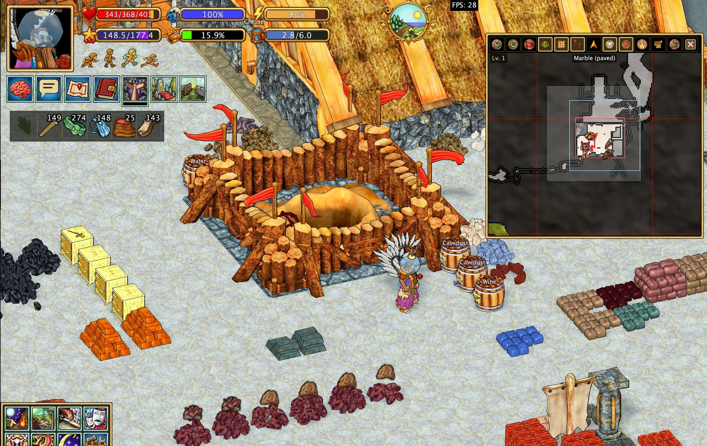

<div align="center">

# Hearthborn Client

**A custom client for Haven & Hearth**

*Plan your village. Simplify production. Explore with better tools.*

[Features](#features) · [Screenshots](#screenshots) · [Getting started](#getting-started) · [Documentation](#documentation) · [Support development](#support-development)

</div>


Hearthborn brings practical tools for village management, crafting, exploration, and everyday play into one client. It includes a village planner, cheese production assistant, automatic timers, meteorite triangulation, improved pathfinding, and configurable interface layouts.

**Languages:** English and Russian · **Build:** Java 22 / Apache Ant

> **Unofficial client.** Hearthborn is an independent client project based on the Haven & Hearth client. It is not the official game client.

## Features

### 🏡 Village and claim planning

Keep a locally saved overview of visited village and personal-claim areas. Find and label observed objects, measure areas in tiles, switch levels, and export plans to HTML or Excel.


[Learn about village and claim plans](docs/features/claim-plan.en.md)

### 🧀 Cheese production assistant

Follow cheese progression for cow, sheep, and goat milk. Inspect aging stages and expected products, see labels on racks, and track observed batches in the **Cheese** tab of Timers.


### ⏱️ Automatic timers

Track observed production processes in one window, with **Automatic**, **Cheese**, and **Manual** tabs. Supported processes include smelters, kilns, finery forges, steel crucibles, cheese racks, herbalist tables, silk production, siege equipment, and more.


[Timers and supported processes](docs/features/timers.en.md)

### 🌠 Meteorite triangulation

Use successive **Star Gaze** observations to narrow the estimated meteorite search area on the map. See direction sectors, numbered measurements, and their overlap; keep track of the server-provided starfall forecast.

*The triangulation view estimates an area, not an exact impact location.*

### 🗺️ Exploration, mapping, and pathfinding

- Route around nearby loaded obstacles with configurable automatic pathfinding.
- View map grid, claim borders, marker names, travel trails, and highlighted terrain.
- Open a detached map and review saved meteorite measurements.
- Display mine-support ranges, mining annotations, and configurable object radii.


[Mining safety and annotations](docs/features/mining-safety.en.md)

### ⚔️ Combat assistance

Stage 1 animal auto-combat selects supported attacks from your active deck during an existing animal fight. A compact combat interface temporarily hides nonessential windows and widgets.


**Alt+Space** toggles compact UI, including outside combat. Auto-combat does not engage targets, handle positioning, or fight other players for you.

### 📦 Storage and production visibility

- Display observed cupboard contents as item icons above cupboards.
- Identify observed stone, clay, brick, metal, and ore stockpiles visually.
- Show cheese rack labels, selected object radii, and useful production information in the world.


[Stockpile materials and ore icons](docs/features/stone-pile-colors.en.md)

### 🛠️ Automation and everyday helpers

The **Xtensions** menu includes helpers for production, farming, travel, mining, and other repetitive tasks. Examples include filling cheese trays, adding fuel to supported objects, harvesting dreams, handling trellis plants, and deploying travel equipment.

[Automation requirements and limitations](docs/features/scripts.en.md)

### 🎛️ Customizable interface

- Choose between the classic **4×4 action menu** and the alternative sidebar menu.
- Move and dock supported panels, toolbars, chat, and windows.
- Customize the map, quest journal, equipment strip, and toolbar layout.
- Adjust panel scaling and select a light interface theme.
- Use English or Russian interface text.



[Magnetic window docking](docs/features/magnetic-windows.en.md)

## Screenshots

| Village planning | Cheese production |
| --- | --- |
|  |  |

| Mining and map tools | Quest journal |
| --- | --- |
|  |  |

## Getting started

### For players

Hearthborn is a custom Haven & Hearth client. Use the release or launcher instructions provided with your distribution. **A verified download or installation URL has not yet been added to this README.**

Once in game, open **Options → UI settings** to configure your layout. Explore the **Xtensions** action menu for automation helpers and the separate **Timers** and planning tools for production and village management.

### Build from source

Requirements: **JDK 22** and **Apache Ant**.

From the repository root:

```sh
ant jars opt/panama
```

See the [original client README](README-vanilla-client) for build targets and dependencies, the [macOS startup script](start-macos.command) for the local Java 22/Cocoa setup, and the [launcher documentation](launcher/README.md) for packaging and releases.

## Documentation

- [Feature documentation (English)](docs/features/README.en.md)
- [Документация функций (Русский)](docs/features/README.ru.md)
- [Village and claim plans](docs/features/claim-plan.en.md)
- [Timers and meteorite triangulation](docs/features/timers.en.md)
- [Mining tools](docs/features/mining-safety.en.md)
- [Automation and scripts](docs/features/scripts.en.md)
- [Magnetic windows](docs/features/magnetic-windows.en.md)

**Important:** Automatic timers, stored object information, and map tools rely on observations and data received by the client. They do not reveal unexplored or unseen information. Automation may stop when supplies, permissions, or reachable objects are unavailable.

## Support development

Hearthborn is free for everyone. Donations are voluntary and help support continued development, bug fixes, and new features. They do not unlock exclusive features or provide in-game advantages.

**[❤️ Support Hearthborn on Buy Me a Coffee](https://buymeacoffee.com/hearthborn_client)**

## Credits and license

Hearthborn is based on the Haven & Hearth client. Original game and client credits belong to their respective authors. See [COPYING](COPYING) for licensing terms and the [original client README](README-vanilla-client) for upstream information.
