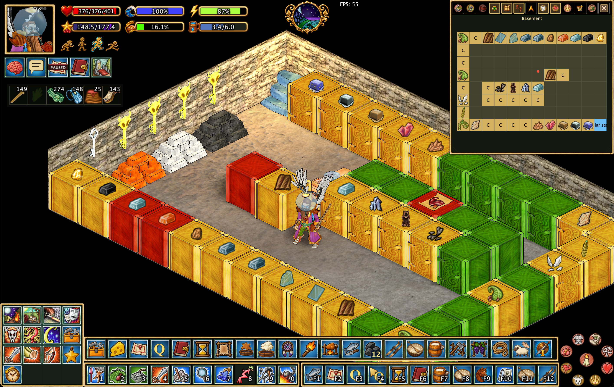
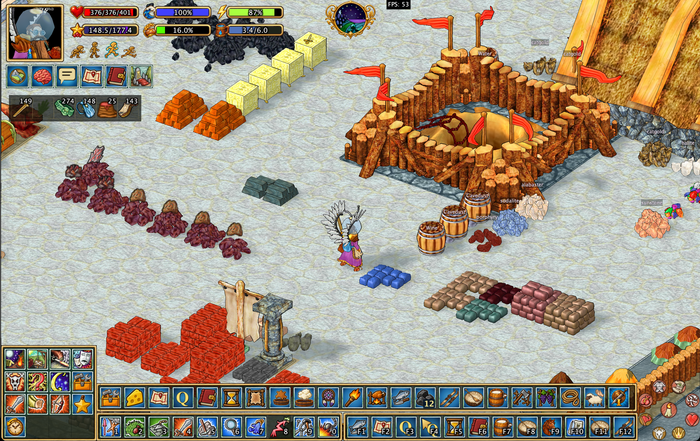
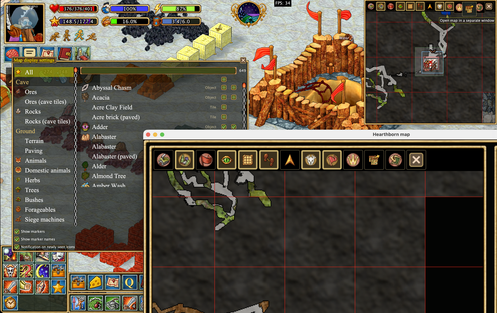
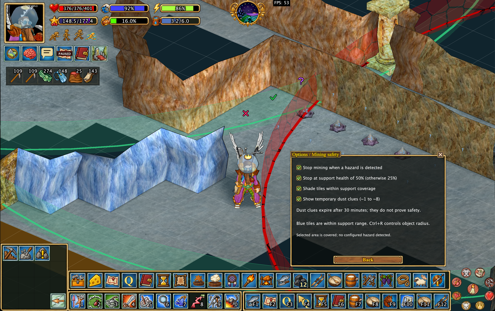

# Hearthborn

**A custom Haven & Hearth client for village management, production, exploration, and everyday play.**

Hearthborn brings village plans, cheese production tools, automatic timers, meteorite triangulation, and practical automation into one client. It also improves navigation, storage labels, mining overlays, and the interface, with English and Russian language support.


## Explore the features

- [Village and claim plans](#village-and-claim-plans)
- [Cheese production assistant](#cheese-production-assistant)
- [Automatic timers](#automatic-timers)
- [Meteorite triangulation and starfall tracking](#meteorite-triangulation-and-starfall-tracking)
- [Animal auto-combat — stage 1](#animal-auto-combat--stage-1)
- [Improved pathfinding](#improved-pathfinding)
- [Automatic cupboard contents icons](#automatic-cupboard-contents-icons)
- [Stockpile materials and ore icons](#stockpile-materials-and-ore-icons)
- [Map improvements](#map-improvements)
- [Mining tools and object radii](#mining-tools-and-object-radii)
- [Automation and useful scripts](#automation-and-useful-scripts)
- [Everyday interface improvements](#everyday-interface-improvements)
- [Build and documentation](#build-and-documentation)

## Village and claim plans

Keep a local overview of your village and personal claims, including terrain, buildings, production objects, and saved observations from previous visits.

- Browse objects in a searchable list and select one to center the plan on it.
- Rename supported objects and mark named areas of the settlement.
- Measure rectangular areas in tiles when planning construction or fields.
- View saved objects on different levels and return to the character's current level.
- Save and rename plans, export them to HTML or Excel, and import or export plan files for sharing.

The plan fills in as you explore. It uses loaded claim data and saved observations; it cannot reveal unexplored areas or automatically confirm every claim permission.


[Read more about claim plans](docs/features/claim-plan.en.md).

## Cheese production assistant

Follow cheese from curd to its next aging stage without keeping a separate reference open.

- Browse cheese progression charts for cow, sheep, and goat milk.
- See tray contents, aging stages, readiness, and the expected next product in an open rack. A remaining hour or more is shown as `49h 17m`.
- Use aging-location information to understand the next transformation.
- Track observed aging processes in the dedicated **Cheese** tab of the Timers window.
- Show cheese rack labels in the world and fill empty trays with the tray-filling helper. A custom house name is drawn above that house's door.

The helper's location selector changes its predictions and tooltips. Moving the cheese to the correct location in the game is still required.


## Automatic timers

Bring production countdowns and personal reminders together in one window, with separate **Automatic**, **Cheese**, and **Manual** tabs.

| Process | What the client tracks |
| --- | --- |
| Ore smelters, stack furnaces, kilns, and finery forges | Supported processing progress observed in the object's window. |
| Steel crucibles | Observed fuel supply, as a fuel countdown. |
| Cheese racks | Aging estimates based on observed cheese and its location. |
| Herbalist tables and silk production | Supported seedling, egg, and cocoon progress. |
| Battering rams and wrecking balls | Preparation time reported by the server after interaction. |
| Personal claims | Activation wait after placement, refined by supported server messages. |
| Starfall | The server's upper estimate after a successful Star Gaze cast. |

Name and sort timers, show countdowns above supported objects, and click an associated timer row to highlight a loaded object. Manual timers can be paused, resumed, and deleted. Running countdowns keep their deadlines across client restarts.

Automatic timers depend on received information, usually from opening the object's window. They are estimates of the last observed state; changes outside the client's view can make them outdated.


[Read more about timers and supported processes](docs/features/timers.en.md).

## Meteorite triangulation and starfall tracking

Turn Star Gaze directions into a map-based search for the meteorite.

1. Cast **Star Gaze** manually at night while it is available, before the meteorite lands.
2. The client saves the casting position and the server's direction sector.
3. Move sideways and cast again from another location.
4. Compare the red sectors and their shared area, highlighted in blue, on the large or detached map.

Red measurement points have visible numbers. Measurements survive reconnects and forecast expiry. When the server removes a previously available Star Gaze action, all triangulation lines, points and shaded areas are cleared automatically on both maps. Loading the menu or hiding the status icon in settings does not clear them. Right-click a measurement point, its number, or the triangulation label to clear all measurements manually while keeping the forecast timer.

While Star Gaze is available, the first status icon announces the event and displays the saved forecast with explicit hours and minutes. A successful cast also adds the forecast to Timers. Three golden shooting stars animate inside the calendar at night during the event.

Triangulation narrows an **estimated search area**. The server supplies direction boundaries, without a distance or an exact impact point. The countdown is an upper estimate, not confirmation that a meteorite has landed.


[Read more about starfall and triangulation](docs/features/timers.en.md#meteorite-triangulation).

## Animal auto-combat — stage 1

The first stage of auto-combat helps choose attacks during an existing fight with an animal.

- Selects supported attacks from the active deck to match the animal's openings.
- Accounts for attack cooldowns and initiative requirements.
- Provides an **Auto: on / Auto: off** control in the combat interface.
- Works alongside combat displays for openings, damage, target highlighting, health, and stamina.

Combat automatically switches to a compact interface: open windows, chat, action menu, toolbars, clock and utility widgets are temporarily hidden. The portrait, health, stamina, energy, hunger and water meters, mount meters, equipment strip, party portraits and combat controls remain available. Hover previews from the equipment strip still work. The existing map moves to the lower-left screen gutter and matches the approximate size of the 4×4 action grid, with its controls hidden to leave room for the map. Its previous size, position, decoration and visibility return afterwards; the combat placement is never saved.

**Alt+Space** toggles this compact view both in and out of combat. In combat, it can restore the full interface until you toggle again or the fight ends. A peace offer, an escaping opponent or disappearance of the attack panel does not restore windows while a combat relationship still exists. If you entered combat with compact view already enabled manually, it stays enabled afterwards. Change the shortcut in **Options → Key bindings → Toggle compact UI**.

This stage automates attack selection against animals. It does not attack player characters or provide a complete hunting routine; you still manage engagement, positioning, and survival.


## Improved pathfinding

Walk around nearby loaded obstacles when clicking the ground or approaching supported stationary objects.

- With **Automatic pathfinding** enabled, ordinary clicks use routing and **Ctrl-click** moves directly.
- With the option disabled, **Ctrl-click** requests routing on foot.
- While mounted, **Ctrl-click** always keeps the game's native dismount handling, regardless of the automatic pathfinding option.
- Movement in water and aboard boats uses native controls, including Ctrl-click and entering water from the shore. Returning to dry land restores normal routing without changing your preference.
- Cancel the route with **Escape**, manual movement keys, or a new movement command.
- Outside houses, right-clicking a building entrance routes to the clicked entrance before sending the original interaction. Ordinary object menus still open first and route after choosing an action.
- Right-clicking a gate keeps the game's native interaction, so a client route to the center of a closed gate cannot block opening it.
- Thingwall clicks and travel actions use the game's native interaction without a route to the stone's center.
- Travel to your hearth fire stays a server teleport. A pending route is dropped and does not walk or turn the character while that channel is running.
- **Sleep** keeps the game's native bed interaction without requiring a client-planned side approach.
- Inside houses and cellars, clicks and object actions use native movement without pathfinding, including Ctrl-click. Cave pathfinding remains available; leaving a house restores normal routing without changing your preference.
- When blocked, the client refreshes nearby obstacles and retries with a wider detour. If no route can be found, movement stops with a red notification.

Pathfinding is local and unavailable during combat. It depends on loaded terrain and collision data, so it cannot plan a journey across unexplored parts of the world.


## Automatic cupboard contents icons

Recognize storage at a glance using item images displayed above cupboards.

- Let the client choose an icon from observed cupboard contents.
- Pick a specific item as the cupboard's icon when you want a custom label.
- Choose whether icons are always visible, shown while holding **Space**, or hidden.
- Keep remembered icons across reconnects using locally saved observations.

Icons are based on contents the client has seen. They do not reveal the inventory of an unopened, unknown cupboard.



## Stockpile materials and ore icons

Tell materials apart in the world instead of opening every pile.

- **Stone, clay, and brick:** piles use the corresponding loose item's material appearance while preserving the pile shape and lighting.
- **Metal bars:** piles use the remembered metal material.
- **Ore:** piles keep their original appearance and show an ore inventory icon above them.
- **Stone names:** hold **Space** to display material names above identified stone piles.

Transfer an item through a stockpile window, or create a pile from an item, to identify its material. Opening a window alone may not identify it. Observed materials are saved locally; transfer another item after changing a pile's contents to refresh the record.



[Read more about stockpile materials and ore icons](docs/features/stone-pile-colors.en.md).

## Map improvements

Keep useful information visible while exploring or organizing a settlement.

- Open the map in a separate window.
- Toggle the grid, view distance, pointers, and marker names.
- Display personal and village claim borders. Personal borders include other people's claims. The village journal still records only your own.
- **General settings → Highlight damaged structures** tints a building, wall or other structure as it wears out and shows the damage, such as 25%. It starts on.
- Show and clear a trail of the current session's movement.
- Highlight selected terrain types and ore tiles.
- Review saved meteorite measurements on both the large and detached maps.




## Mining tools and object radii

Combine support information, mining annotations, and configurable range overlays.

- Show mine support ranges and shade tiles within their geometric coverage.
- Distinguish supports with reported damage using red range overlays.
- Check queued mining selections and stop mining when a supported hazard is detected.
- Annotate tiles with crosses, check marks, and question marks.
- Optionally display observed dust clues and pin selected clues for later reference.
- Configure supported object radii, such as beehives, troughs, and mine supports, to appear by command or remain visible.

**Ctrl+R** toggles radii configured to appear by command. Mining checks use loaded objects and received data; coverage shading and manual check marks do not guarantee protection from cave-ins.



[Read more about mining safety and annotations](docs/features/mining-safety.en.md).

## Automation and useful scripts

The **Xtensions** menu groups helpers into Production, Farming and animals, Travel, Mining and building, and Combat. Hover an action for its requirements and brief instructions. Supported actions can also be assigned shortcuts.

| Task | Available helpers |
| --- | --- |
| Production | Harvest dreams, roast food on a spit, fill cheese trays, butcher fish, collect finished drying frames and leather. |
| Fuel and lighting | Add branches to an oven, wood blocks to a smoke shed, or coal to a smelter; light an object with a torch. |
| Farming and animals | Harvest or remove a nearby trellis plant, use clover or rope, shoo an animal, collect milk into a cistern, open the cattle roster. |
| Travel | Deploy or pick up a coracle or skis; call and mount a horse. |
| Mining and building | Dig a cellar, chip ordinary boulders, and use the mining annotation cursor. |
| Combat shortcuts | Activate saved combat schools, dismount a rider, and clear damage displays. |

The milk collection helper works on a selected pen of one species and transfers milk through an empty barrel into a fixed nearby cistern. Each barrel logs its amount and quality after being placed and opened, before pouring; prompts, errors and completion use the notification line. Dream harvesting visits nearby loaded dream catchers. Each helper has its own range and inventory requirements.

**Escape cancels further script actions.** Helpers wait for server updates and can stop when supplies, access, or space are missing. Cellar digging and stone chipping drop resulting cursor-held stones onto the ground.


[Read more about automation behavior and requirements](docs/features/scripts.en.md).

## Everyday interface improvements

Entering a house from outside sets the camera three wheel steps from its closest zoom while keeping your view direction. The zoom is applied before the first ready room frame; while its map data loads, the loading view stays visible. Moving between floors or into a cellar preserves your current zoom. Leaving restores the previous outdoor zoom and view direction; ordinary cave travel keeps its current camera.

Dewy Lady's Mantle appears as a blue status icon beside the study reminder during its 04:45–07:15 game-time collection period. The icon shows the remaining real time, with a detailed countdown on hover. **General settings → Lady's Mantle notification** controls the icon and the existing start/end alerts; the countdown no longer appears below the clock.


Hovering the clock opens one framed note to the right of the pointer: world, game date and clock, real time until night or morning, season and real days until the next one, moon, players online, ping, province and realm. Near the right edge of the screen the note moves to the left of the pointer. The on-screen server-status lines are gone. FPS sits to the right of the clock, white letters on a black background. **UI settings → Show ping** adds the round-trip time on the line below it.

Right-click the water and tea meter to open a Drink petal. It uses Adventures → Drink. **General settings → Auto-drink below stamina** repeats that drink while stamina is at or below 25%, 50% or 75%. Off leaves it manual. Hovering the meter shows whether auto-drink is on and which level it uses. It waits during another action and does not drink when the character has no water or tea.

The character portrait and status meters use 1.4× magnification. **Portrait on the right** mirrors that cluster: the portrait sits in the top-right, the status bars and effect widgets open to its left, and the combat panel moves to the top-left. FPS and ping then sit to the left of the clock. The health meter shows soft/hard/maximum hit points, such as 300/300/300, instead of a percent. Stamina and energy stay as percents. Left-click the portrait to open Equipment; right-click it to open the Character Sheet. Either click again closes that window. Inventory, Equipment, Character Sheet and Kith & Kin sit inside the bottom of the portrait, on a black bar. Those menu buttons remain in place. Portrait and frame clicks never pass through to move the character in the world. The speed selector retains its 1.5× size. Effects and helper widgets below the portrait, including study and the journal, use 1.25×. The speed selector uses painted movement icons, switching to horse poses while riding. The selected speed has a cyan outline; unavailable speeds are dimmed. Aboard a boat the selector is hidden. Clicks, wheel controls and speed shortcuts are unchanged. The equipment strip uses a smaller 1.3× scale with no outer gold frame. Its **Vertical** switch in **Options → UI settings** stacks the slots, shrinking to fit the window height when needed. Each item's quality is a whole number in the top-right of its icon. Item actions, edge dragging, snapping and window-resize limits are preserved. Inventory grids, items and quality labels are 10% larger, with their original cell assignments and item actions. Cells outside the usable area keep a visible grid. Header buttons are slightly larger.

The Sidebar menu is a separate panel in the same gold frame as the additional toolbar. Its column is Adventure, Build, Craft, Emotions, Government, Help, Rite and Magic, Xtensions, History, Favorites, Attack, Push! and Shoot. Click one and its icons slide out beside the column. **Right**, next to Sidebar menu, puts the column on the right and the Radial Menu on the left; the icons then slide out to the left. A folder in that row fills the squares below the row, beside the column. Opened icons stay within seven cells and continue on the next row, starting beside the clicked button. When that first row has fewer than seven icons, the strip is one cell wider than the icons. The frame does not cover the buttons above it. A pack opened from that row shows its own folders. Opening one of those shows the actions inside them, not another layer of folders. Those icons continue in the empty cells of the last row and start a new row only when that row is full. The icons already open stay in place. Click the branch again to close it. Drag a button onto the F-key, numeric or additional toolbar to place a copy there; the button stays in this menu. Opening a row does not move panels snapped to the column. A click outside the panel, or choosing an action that is not a folder, folds the open rows. While that strip is shown, the 4×4 menu is hidden, and the Radial Menu of map and claim buttons takes the menu's corner. The button strip along the bottom starts to the right of the vertical column, with a gap. Chat stays in its own window. **UI settings → Sidebar menu** shows the strip, and **Classic (grid) menu** shows the 4×4 instead. Choosing one turns the other off. With the classic grid, the Radial Menu sits in the opposite bottom corner, and choosing the other side swaps the two. Drag its background, or hold Alt/Option and drag an icon, to move it.

The **F-key**, **numeric** and **additional** toolbars use a 1.40× size when floating and when attached to the bottom. Drag their edges or the gaps between buttons to move them; on a trackpad, hold Alt/Option (⌥) and drag from any icon. Hold the primary click while moving, then release it to place the panel; ordinary taps still activate icons. The equipment strip moves by dragging its frame, or with Alt/Option on an icon. The separate handles and locks are removed. Turn off **Gold frames on separate toolbars** in UI settings to hide the outer gold frame on the floating strips, on the toolbar attached to the bottom, and on the Classic (grid) menu, while keeping edge dragging and snapping. **Options → UI settings** opens a small standalone window and hides the larger Options window. Back closes it and returns to Options. **Show** and **Vertical** apply only to a toolbar that is separate from the bottom bar. **None** leaves the F-key, numeric and additional toolbars separate. **Numeric toolbar** leaves the F-key and additional toolbars separate. **Additional toolbar** leaves the F-key and numeric toolbars separate. **Numeric + F** leaves only the additional toolbar separate. The equipment strip is always separate. It also controls equipment and status indicators. **Light interface** switches panels, inventories and the equipment strip to a pale stone color; chat stays dark. **Left**, beside **Classic (grid) menu** in the same column as **Vertical**, moves that grid to the bottom-left corner and places the bottom toolbar to the right of it. Icon order and menu navigation stay the same. Chat is always a separate window: drag its edges to resize it, and drag the window to move it. Tabs show icons while the names do not fit, and the names once they do. Shrinking the window switches the names back to icons. It snaps to the bottom toolbar and, at the menu corner, to the Radial Menu. There is no collapse control. Ctrl+C focuses the window. **Show numeric toolbar** hides or restores the numeric strip while keeping its shortcuts, slots and layout preferences. In numeric + F mode, hiding the numeric strip restores the separate F toolbar. In **Toolbar attached to bottom**, choose **None**, **Numeric toolbar**, **Additional toolbar**, or **Numeric + F toolbar**. Selecting an attached toolbar automatically enables its visibility checkbox; numeric + F enables both. Clearing **Show F-key toolbar** does not switch Numeric + F to Numeric: those keys stay on the bottom bar. None detaches the strips while keeping their visibility choices. Attached strips expand to the chat width with 1.5× icons and stay on the bottom edge of the screen. The bottom toolbar stays on the screen edge; the chat window does not move it. The attached additional toolbar fills complete rows across that width: its original thirteen slots stay first, followed by extra cells for menu actions saved locally per character. New cells retain assignments when hidden by narrowing or undocking the strip; inventory-item bindings remain available in the original slots. Numeric mode shows adjacent action pages; numeric + F shows the selected numeric page followed by F1–F12, wrapping if space is limited. Alt+1…0 still selects the numeric page. Other strips remain separate, and detaching restores saved positions without changing action assignments.

**Options → UI settings → Panel scale** changes the game interface from 0.75× to 2× independently of the general Interface scale. Portrait, indicators, action menu, toolbars, chat, journal and other game UI windows follow it; the map and its buttons, inventory, container and equipment windows retain their size. The general Interface scale still affects the whole client.


The **Quest journal** is a movable, magnetic window listing all current quests as equal-height cards with a title and objective progress. The book button in the buff row, immediately after the village plan, opens the window and closes it on the next click. Hovering that button shows the active quest and its objectives. The pursued credo quest appears first and scrolls with the rest. Left-click a card to activate that quest and its native pointers without opening Character Sheet; clicking it again keeps it active. The pointer shows the distance in tiles. Right-click opens its page in the full journal. Drag the lower-right corner to change width and snap the height to whole cards, down to one; scroll with the same gold thumb as the chat to reach every other quest without changing the font size. Objective details appear on hover after selecting a quest; the client no longer switches quests in the background to fetch them. An unfinished objective that names a known item, such as chives, shows that item's picture after the name and quantity. The same picture appears in the Character Sheet quest log. The match follows the English objective, so the picture remains when the line is translated. Position, width and visible card count are saved. **Show quest journal** in UI settings controls visibility; the close button hides it, and the existing Quest journal action restores it. The old pinning and compact/list settings are removed.

The equipment window shows three lines under the character's feet: Detection (perception × exploration), Subtlety (intelligence × stealth), and Armor Class as the total of hard and soft armor that is not worn out. Bunny slippers stay in the boots slot and on the character. **Auto-Switch Bunny Slippers/Armor Boots**, on the equipment window and in General settings, equips bunny slippers when you right-click a rabbit and the best armor boots from the main inventory otherwise: plate boots, armored striders, ranger's boots, then leather boots. A right click on empty ground leaves the current pair alone. The switch starts enabled. The equipment strip shows left hand, right hand, belt, backpack, Left Hand Pouch, Right Hand Pouch, shoulders/wings and cape, in that order. The **…** button next to its **Vertical** checkbox opens slot settings; both hands stay visible and the other six slots can be hidden independently. Hovering the backpack shows its contents, or a bag-style popup of the main inventory when the game uses the backpack to extend that inventory. The popup shows the live inventory grid without its title or side panel; item actions and tooltips still work, and leaving it closes the preview. An ordinary left or right click on the inventory slot, or the usual Inventory button/shortcut, opens the full inventory with its controls at its saved position. Shift/Ctrl item actions and other equipment slots retain their usual behavior. Already open inventories keep their position. Vertical equipment tooltips appear beside the hovered row. Separate additional toolbars have uniform spacing without the larger F-key group gaps.

The in-game map keeps its buttons on a black strip along the top of the map, inside the frame. Every button is the same square: its icon is scaled inside one shared frame, and a bronze plate with a gold frame shows that the button is on. When the map is too narrow, the squares shrink together and stay on one row, so the map keeps its height. The order is home, compact view, the separate map window, New marker, then view distance, grid, pointers, icon settings, marker names, personal and village claim borders, the session trail, and the original hide and province buttons. New marker is hidden while the map is in compact view. The personal and village buttons use the same claim and village icons as the Radial Menu. Drag the bottom-left corner — the same resize icon as a detached chat window — left to widen the map while keeping its right edge fixed, or down to increase its height. The compact map's bottom-right resize remains available. Double-click either corner to return the map to the size and place it had before that stretch. Turning compact view off detaches the minimap and opens the large map in the center the first time. After that, the large map reopens at the last place and size it was left, the same way container windows remember their place. Closing the large map, or turning compact view on again, puts the minimap back where it was, still attached when it had been magnetized to another window.

- **System controls:** Minimize is a root entry in the 4x4 action menu. Search actions is only in the center of the Radial Menu. A restore button appears in the chosen bottom corner only while the menu is minimized. Minimizing the grid leaves the Radial Menu where it is. The restore button is twice the old size on either side. With the grid on the left, the minimize arrow points toward that corner and the restore arrow points toward the upper right. Map, personal claims, village claims, provinces and Options sit in the Radial Menu. Search actions is in the center. Clockwise from the top the ring is map, settings, provinces, village claims, personal claims, kin, and inventory. There are no captions. **Classic (grid) menu** keeps the 4×4 and places the Radial Menu in the opposite bottom corner. The grid stays at 1.40× and does not grow when the pointer is over it. Its **Left** checkbox swaps the two corners and does not move the Radial Menu while Sidebar menu is on. **Sidebar menu** hides the 4×4 and moves the Radial Menu into that corner. Its **Right** checkbox puts the column on the right and the Radial Menu on the left. Selecting either menu turns the other off. Inventory, Equipment, Character Sheet and Kith & Kin sit inside the bottom of the portrait, on a black bar. The row uses native-size system icons and shares one straight frame with the enlarged grid. The duplicate bottom-left minimap is removed. **Icon settings** on the map button strip opens **Map display settings**, combining object icons and tile highlights in one searchable list. The category list opens on All, so search covers every entry until another category is chosen. Cave follows, with ore and rock icons and their cave tiles. Ground then holds Terrain, paving and the remaining object icons. The checkbox above the display column selects only the open category. A checked tile is highlighted on the map, and clearing it removes the highlight. Object sound and permanent-marker options remain available when selecting an object. Existing selections and sounds are retained. The 4×4 action menu defaults to the lower-right corner, with an optional left-hand position in UI settings, a straight frame and 1.40× controls; its hierarchy and navigation are preserved. When attached to chat, the numeric action bar uses the same enlarged icon size, showing fewer adjacent pages when needed and compressing only if one full page cannot fit.
- **Action menu:** two entries in the root 4×4 menu open **Favorites** and **Recent actions**, each with 15 action slots and **Back** in the bottom-right cell. Right-click an action to add or remove a favorite. Recent actions have no duplicates; passive recipe previews do not enter the history. Both lists are saved locally and share their data with action search.
- **Inventory tools:** quality labels, stacking and unstacking, sorting, grouped contents, and configurable drop rules in the character inventory. Inventory cells use the equipment strip's dark background and thin gold outline. Blocked cells are darker and hatched, so they stay visible.
- **Quality records:** tools for recording and browsing observed quality information.
- **World visibility:** configurable cupboard, wall, and fence heights; plant visibility and growth information; animal and critter markers. A dangerous animal in Map display settings has its own warning checkbox. Dead and knocked-out animals do not play a warning. Its sound can follow the general warning, always use the spoken name, always use the animal call, or play a chosen WAV file. Play previews that choice. Changing the general warning changes only animals left on the general choice. Animal and other player warnings, and the horse whistle, use **Warning volume** in Audio settings, so Interface sound volume and in-game event volume can be lowered without silencing them.
- **Players and parties:** **Map display settings → Players** controls nearby arrows for friends (green), village residents (blue), other known players (gold), and unknown or explicitly hostile players (red). Nearby players appear independently of the old icon color-group filters; village membership alone does not provide distant coordinates. Party arrows share the painted player-arrow shape, with a light and dark outline for contrast, and retain server tracking and party colors. **Show party member names** in **General settings** restores known names and remembers them while that map remains open. Party controls occupy free space below the upper HUD and avoid the quest journal, map and chat without changing their saved positions.
- **Player warnings:** speaks “Friend,” “Villager,” “Acquaintance,” or “Enemy” according to received kinship information. An explicitly red kin group is hostile; village residents have their own category, green kin and party members are friends. Other named characters are acquaintances; unknown characters use “Enemy.” The wizard who stands in the starting area, mannequins, and carved character statues, standing or knocked down, are ignored. Enabled by default; toggle **Other player warning sounds** in **General settings**. Speech follows the interface language and works independently of animal sounds.
- **Study and equipment:** study progress and reminders, curiosity information, and equipment bonuses.
- **Window layout:** compact decoration; floating toolbars, equipment and in-game windows snap to screen edges or adjoining panels. Attached panels follow their anchor; drag one away to detach it.
- **Language:** English and Russian interface options, including translated tooltips and messages.


[Read more about magnetic window docking](docs/features/magnetic-windows.en.md).

## Build and documentation

The client is built with **JDK 22** and **Apache Ant**. From the repository root:

```sh
ant jars opt/panama
```

Build targets and dependency handling are described in the [original client README](README-vanilla-client). For the local macOS setup, the [startup script](start-macos.command) uses Java 22 and the Cocoa graphics backend. See the [launcher documentation](launcher/README.md) for native launcher packaging and release preparation.

- [English feature documentation](docs/features/README.en.md)
- [Russian feature documentation](docs/features/README.ru.md)
- [Screenshot replacement guide](docs/images/README.md)

## Credits and license

Hearthborn is based on the Haven & Hearth client. Original game and client credits belong to their respective authors. See [COPYING](COPYING) for license terms and the [original README](README-vanilla-client) for upstream information.
