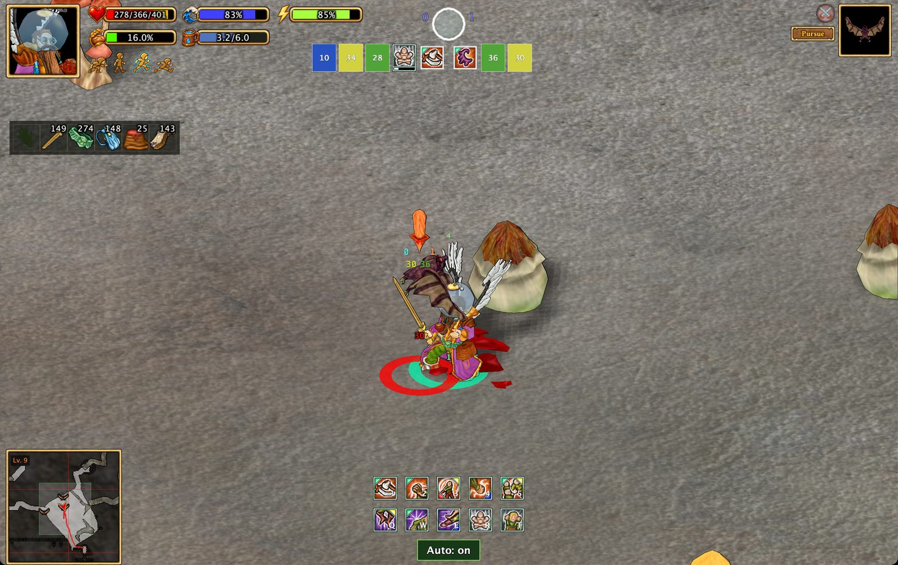
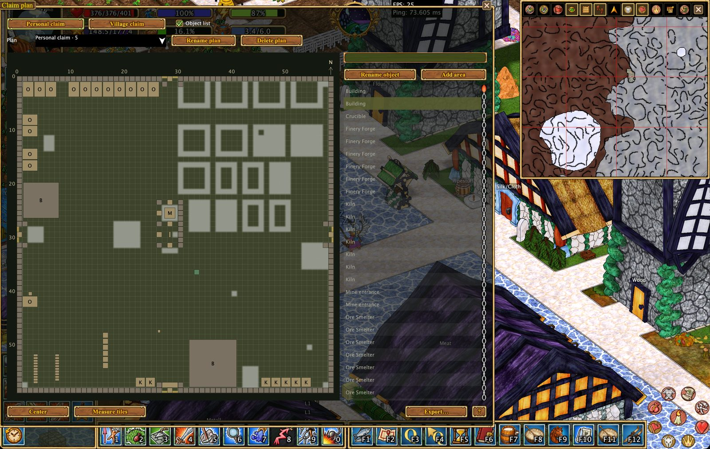
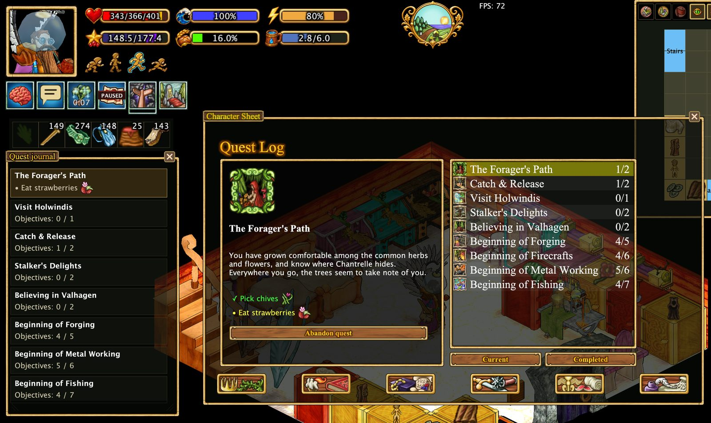

<div align="center">

# Hearthborn Client

**A custom client for Haven & Hearth**

*Plan your village. Simplify production. Explore with better tools.*

[Features](#features) · [Screenshots](#screenshots) · [Getting started](#getting-started) · [Documentation](#documentation) · [Support development](#support-development)

</div>


### 🎛️ Redesigned & fully customizable interface

Hearthborn features a redesigned interface that adapts to how **you** play. Arrange your HUD for a clean view of the world, a compact corner layout, or a workspace with toolbars and panels exactly where you need them.

- **Two action-menu styles:** Keep the familiar classic **4×4 grid**, or switch to the expandable **Sidebar Menu**. The classic menu retains its original action hierarchy.
- **Flexible toolbars:** Move F-key, numeric, and additional action bars; arrange them horizontally or vertically, or attach supported bars along the bottom of the screen.
- **Drag, dock, and snap:** Reposition toolbars and supported windows, and snap them to nearby panels or screen edges.
- **Left- or right-handed layouts:** Move the character portrait and status bars together to the right side of the screen, with surrounding indicators adjusting their positions; swap action-menu corners as preferred.
- **Independent UI scaling and frames:** Adjust panel sizes and portrait scale, switch between dark and light themes, and enable or disable decorative gold frames on supported toolbars.
- **Quest journal and equipment tools:** Keep quest objectives visible in a movable journal, and customize the equipment strip and status indicators.
- **Compact mode:** Press **Alt+Space** to temporarily hide nonessential UI, including during combat.


[Explore interface layouts and controls](docs/features/interface.en.md)

Hearthborn brings practical tools for village management, crafting, exploration, and everyday play into one client. It includes a village planner, cheese production assistant, automatic timers, meteorite triangulation, improved pathfinding, and configurable interface layouts.

**Languages:** English and Russian · **Build:** Java 22 / Apache Ant

> **Unofficial client.** Hearthborn is an independent client project based on the Haven & Hearth client. It is not the official game client.

## Features

### 📒 Quality roster

Keep a **quality journal** for objects and resources you encounter, so useful quality values are easy to find later.

- **Q button:** Opens the **Quality roster**, where you can browse recorded entries across categories such as buildings, trees, seeds, saplings, and barrels.
- **Q with an arrow:** Activates the quality-recording tool. Use it on an object to read its quality and add the observation to the journal.
- **Quality on your plans:** Recorded object quality can also be displayed directly on the **village plan** or **personal claim plan**, connecting your journal entries with their locations.


### 🏡 Village and claim planning

Keep a locally saved overview of visited village and personal-claim areas. Find and label observed objects, measure areas in tiles, switch levels, and export plans to HTML or Excel.


| # | Feature | How it appears in the plan |
| --- | --- | --- |
| **1** | **Named areas** | Add an area and give it a useful name, such as *Leather Storage*, to mark where hides or other materials are kept. |
| **2** | **Named houses** | Rename a house in the plan. The same name also appears above the house in the game world. |
| **3** | **Tree quality** | Trees recorded in the **Quality Journal** display their known quality on the plan. |
| **4** | **Furnaces and smelters** | Production equipment is added to the plan automatically. Its quality is displayed when that value is recorded in the **Quality Journal**. |
| **5** | **Village idol** | The village idol is shown as part of the settlement layout. |
| **6** | **Chicken coops and rabbit hutches** | Animal-keeping structures are represented on the plan. |
| **7** | **Tanning tubs** | Leather-processing tubs appear in their observed locations. |
| **8** | **Drying racks** | Leather drying racks are shown as part of the production area. |

[Learn about village and claim plans](docs/features/claim-plan.en.md)

### 🧀 Cheese production assistant

Follow cheese progression for cow, sheep, and goat milk. Inspect aging stages and expected products, see labels on racks, and track observed batches in the **Cheese** tab of Timers.


I also added a **cheese progression chart** to make it easier to plan cheese production and choose the right aging stages and locations.


### ⏱️ Automatic timers

Hearthborn automatically creates background timers for supported in-game processes as they are observed, then notifies you when they are ready. Spend less time repeatedly checking production equipment and more time playing.

**Supported processes include:**

- **Ore smelters, kilns, ovens, and finery forges:** Track processing and receive completion notifications.
- **Steel crucibles:** Monitor the observed fuel countdown and get reminders when more fuel is needed.
- **Cheese production:** Follow aging stages and see when the next stage is expected.
- **Silk production and herbalist tables:** Track supported growth and processing stages.
- **Battering rams and other siege equipment:** Track preparation time and know when equipment becomes usable.
- **Personal claims:** Follow the activation countdown after placement.

All countdowns are collected in one window with **Automatic**, **Cheese**, and **Manual** tabs. You can also create your own timers. Additional processes will be supported in future updates.

*Automatic timers use the latest information received by the client, often when you interact with an object. If a process changes while it is unobserved, its estimate may become outdated. Saved deadlines continue counting down across client restarts.*


[Timers and supported processes](docs/features/timers.en.md)

### 🌠 Meteorite triangulation

Use successive **Star Gaze** observations to narrow the estimated meteorite search area on the map. See direction sectors, numbered measurements, and their overlap; keep track of the server-provided starfall forecast.

*The triangulation view estimates an area, not an exact impact location.*

### 🧭 Improved pathfinding

Hearthborn reworks the default pathfinding to make everyday movement smoother and less intrusive. It is **enabled by default**, but you can turn it off in the settings if you prefer direct movement controls.

- Automatically navigates around nearby obstacles without getting in the way of normal play.
- **Not used during combat, while swimming, or when traveling by boat.**
- **Optional horseback pathfinding** can be enabled separately. It is off unless you choose to use it.

### 🗺️ Redesigned mapping and exports

The mapping system has been reworked, including how explored map data is saved and exchanged between clients.

- **Export and import map data** to transfer your explored map to another client.
- **Export the map as an image** for sharing or reference.
- **Export map tiles** when you need the individual tile images.
- No separate disk-recording mode: unnecessary continuous writing to disk has been left out.

### 📍 Map icons and display settings

Map markers have been expanded with many additional icons, making it easier to recognize objects and points of interest. Animal indicators can also provide **animal sounds**.

The **Map Display Settings** have been redesigned, and the map includes a dedicated **Icon Settings** control for managing the icon display.


The map tools also include mine-support ranges and configurable object radii.

### 💣 Reimagined mining Minesweeper

I've reworked the mining **Minesweeper** tool around how I believe it should work: a practical way to mark cave tiles and interpret dust warnings, rather than a system that pretends to know which tiles are safe.

- **Mark tiles yourself:** Cycle through a red cross, green check, purple question mark, or no mark.
- **Record dust clues automatically:** When the game reports a cave dust warning, the client displays a numbered clue from 1 to 8. Temporary clues expire after 30 minutes; you can pin them to keep them.
- **Inspect nearby tiles:** Hover over a clue to highlight its eight neighboring tiles and review the conditions recorded when the dust appeared.
- **Keep your notes:** Manual marks and pinned clues are saved with the map, while temporary observations disappear when you exit the client.

The Minesweeper annotation cursor keeps marking clicks separate from mining actions. Automatic mining-stop protections remain an independent setting. **Clues help you plan, but they never guarantee that mining is safe.**

[Mining safety and annotations](docs/features/mining-safety.en.md)

### 🔎 Redesigned action search

The default **Action Search** has been reworked into a more useful action browser. Find commands without navigating through multiple menu levels, and review the selected action directly.

- Search across actions, crafting, and construction.
- Switch between **Favorites** and **History**.
- Mark frequently used actions as favorites.
- See an action's menu path and, for supported crafting recipes, the ingredients and crafting details.
- Use **Search by ingredient** to find recipes based on materials.


### ⚔️ Combat assistance

Stage 1 animal auto-combat selects supported attacks from your active deck during an existing animal fight. A compact combat interface temporarily hides nonessential windows and widgets.



**Alt+Space** toggles compact UI, including outside combat. Auto-combat does not engage targets, handle positioning, or fight other players for you.

### 📦 Storage and production visibility

- Display observed cupboard contents as item icons above cupboards.
- Identify observed stone, clay, brick, metal, and ore stockpiles visually.
- Show cheese rack labels, selected object radii, and useful production information in the world.


[Stockpile materials and ore icons](docs/features/stone-pile-colors.en.md)

### 🛠️ Automation and everyday helpers

The **Xtensions** menu includes helpers for production, farming, travel, mining, and other repetitive tasks. Examples include filling cheese trays, adding fuel to supported objects, harvesting dreams, handling trellis plants, and deploying travel equipment.

[Automation requirements and limitations](docs/features/scripts.en.md)


## Screenshots

| Village planning | Cheese production |
| --- | --- |
|  |  |

| Mining and map tools | Quest journal |
| --- | --- |
|  |  |

## Getting started

### For players

Hearthborn is a custom Haven & Hearth client. Use the release or launcher instructions provided with your distribution. **A verified download or installation URL has not yet been added to this README.**

Once in game, open **Options → UI settings** to configure your layout. Explore the **Xtensions** action menu for automation helpers and the separate **Timers** and planning tools for production and village management.

### Build from source

Requirements: **JDK 22** and **Apache Ant**.

From the repository root:

```sh
ant jars opt/panama
```

See the [original client README](README-vanilla-client) for build targets and dependencies, the [macOS startup script](start-macos.command) for the local Java 22/Cocoa setup, and the [launcher documentation](launcher/README.md) for packaging and releases.

## Documentation

- [Feature documentation (English)](docs/features/README.en.md)
- [Документация функций (Русский)](docs/features/README.ru.md)
- [Village and claim plans](docs/features/claim-plan.en.md)
- [Timers and meteorite triangulation](docs/features/timers.en.md)
- [Mining tools](docs/features/mining-safety.en.md)
- [Automation and scripts](docs/features/scripts.en.md)
- [Interface customization](docs/features/interface.en.md)
- [Magnetic windows](docs/features/magnetic-windows.en.md)

**Important:** Automatic timers, stored object information, and map tools rely on observations and data received by the client. They do not reveal unexplored or unseen information. Automation may stop when supplies, permissions, or reachable objects are unavailable.

## Support development

Hearthborn is free for everyone. Donations are voluntary and help support continued development, bug fixes, and new features. They do not unlock exclusive features or provide in-game advantages.

**[❤️ Support Hearthborn on Buy Me a Coffee](https://buymeacoffee.com/hearthborn_client)**

## Credits and license

Hearthborn is based on the Haven & Hearth client. Original game and client credits belong to their respective authors. See [COPYING](COPYING) for licensing terms and the [original client README](README-vanilla-client) for upstream information.
