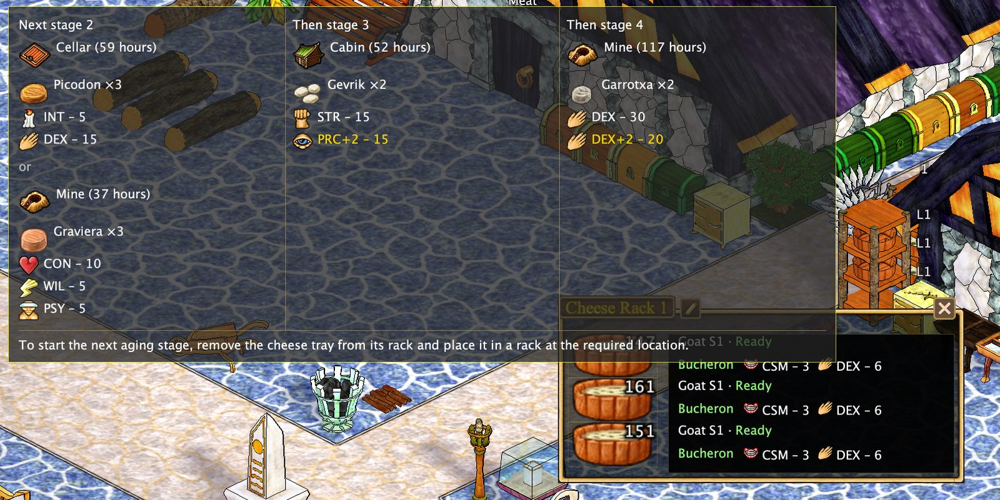
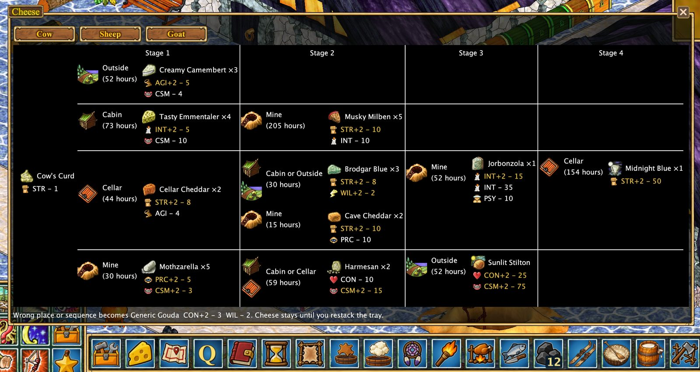

# Cheese production assistant

Follow cheese progression for cow, sheep, and goat milk. Inspect aging stages and expected products, see labels on racks, and track observed batches in the **Cheese** tab of Timers.

I also added a **cheese progression chart** to make it easier to plan cheese production and choose the right aging stages and locations.

[Back to features](../index.md#features)
