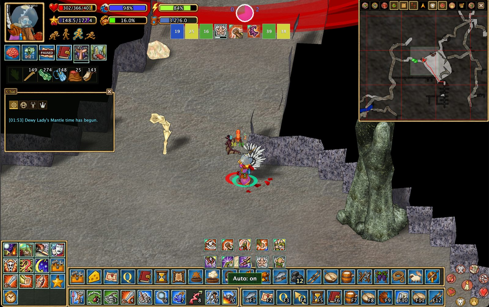

# Combat assistance

## Animal auto-combat

Stage 1 animal auto-combat is intended to help newer players with simpler encounters, such as ants and bats. During an **existing animal fight**, it automatically uses supported **attacks** against the target. **Combat moves are not yet used**; further development is planned.

It does **not** engage targets, position your character, or fight other players for you.

## Compact interface

The compact combat interface temporarily hides nonessential windows and widgets so you can focus on the fight. Press **Alt+Space** to toggle compact UI, including outside combat.

[Interface customization](interface.en.md) · [Back to features](../../README.md#features)

---

## Original README feature overview

## 📦 Storage and production visibility

- Display observed cupboard contents as item icons above cupboards.
- Identify observed stone, clay, brick, metal, and ore stockpiles visually.
- Show cheese rack labels, selected object radii, and useful production information in the world.

