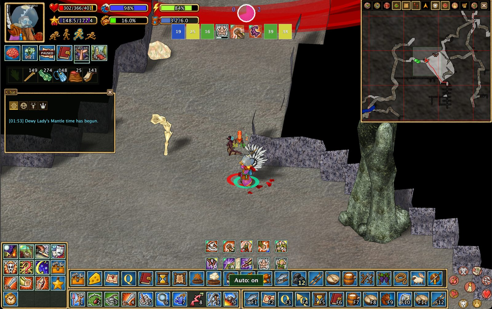

# Помощь в бою

## Автоматический бой с животными

Первая версия автоматического боя с животными предназначена для помощи начинающим игрокам в простых столкновениях, например с муравьями и летучими мышами. Во время **уже начавшегося боя с животным** клиент автоматически использует поддерживаемые **атаки** по цели. **Боевые приёмы пока не используются**; дальнейшее развитие запланировано.

Функция **не начинает бой**, не управляет позиционированием персонажа и не сражается с другими игроками вместо вас.

## Компактный интерфейс

Компактный боевой интерфейс временно скрывает второстепенные окна и виджеты, чтобы вы могли сосредоточиться на сражении. Нажмите **Alt+Space**, чтобы переключить компактный режим, в том числе вне боя.

[Настройка интерфейса](interface.ru.md) · [Назад к возможностям](../../README.md#features)
