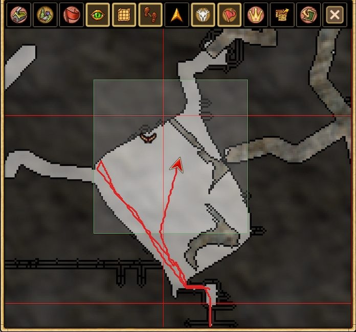
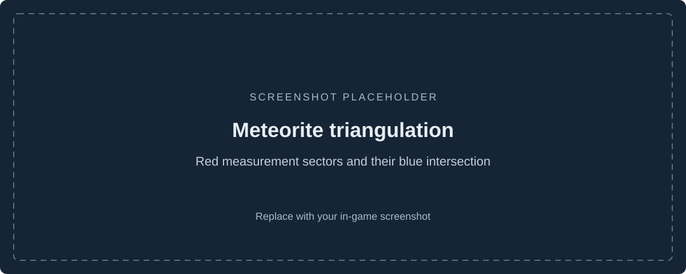

# Navigation, mapping, and exploration

## Improved pathfinding

Hearthborn's reworked pathfinding helps navigate around nearby obstacles without interrupting ordinary movement.

- **On foot:** Improved pathfinding is **enabled by default**. Disable it in settings, or temporarily bypass it with **Shift+click**.
- **On horseback:** Improved pathfinding is supported but **disabled by default**. Enable it separately in settings if you want to use it while riding.
- **Exceptions:** Improved pathfinding is not used during combat, while swimming, or while traveling by boat.

## Redesigned mapping and exports

The map-saving system has been reworked. You can:

- **Export and import map data** to move an explored map between clients.
- **Export a map image** for sharing.
- **Export map tiles** as individual images.

There is no separate continuous disk-recording mode.

## Session trail

**Show Session Trail** displays the route traveled during the **current session** on the map. It is temporary: the trail **is not recorded to disk or retained between sessions**.

## Map icons and display settings

Hearthborn adds more map icons and **animal sounds**. **Map Display Settings** have been redesigned, and a dedicated **Icon Settings** control is available on the map. The map can also show supported mine-support ranges and object radii.

## Redesigned Action Search

The updated **Action Search** helps locate actions without navigating nested menus.

- Search actions, crafting, and construction.
- Switch between **Favorites** and **History**.
- Save frequently used actions as favorites.
- Review action menu paths and supported recipe ingredients.
- Use **Search by ingredient** to locate recipes.

## Meteorite triangulation

Use successive **Star Gaze** observations to narrow a meteorite's estimated search area. The map displays direction sectors, numbered measurements, and their overlap alongside the server-provided starfall forecast.

The result is an **estimated area**, not a precise impact location.

[Mining safety and Minesweeper](mining-safety.en.md) · [Back to features](../../README.md#features)
