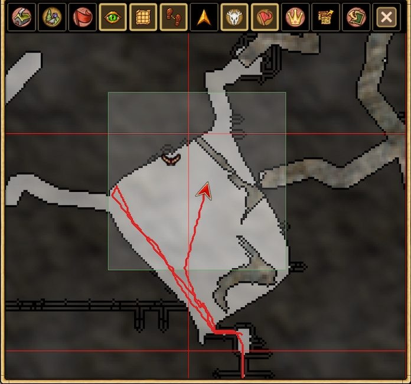

# Навигация и исследование

## Поиск пути

При движении пешком улучшенный поиск пути включён по умолчанию. **Shift + щелчок** позволяет временно обойти его; также его можно отключить в настройках. Для верховой езды предусмотрена отдельная опция, **по умолчанию отключённая**. Поиск пути не применяется во время боя, плавания или передвижения на лодке.

## Карта и экспорт

Можно экспортировать и импортировать уже исследованные участки карты, сохранять изображение карты или отдельные тайлы. Постоянная фоновая запись карты на диск не требуется.

## Маршрут текущей сессии

**Show Session Trail** показывает пройденный маршрут на карте только в текущей игровой сессии. Маршрут не сохраняется между запусками.

## Значки и отображение

Дополнительные значки карты, звуки животных, настройки отображения объектов и радиусов опор шахты.

## Поиск действий

Обновлённый поиск поддерживает историю, избранное, рецепты и поиск по ингредиентам.

## Поиск метеоритов

Наблюдения **Star Gaze** позволяют сопоставить направления и оценить область возможного падения метеорита. Это приблизительная зона, а не точная точка удара.

[Все функции](../index.md#features)
