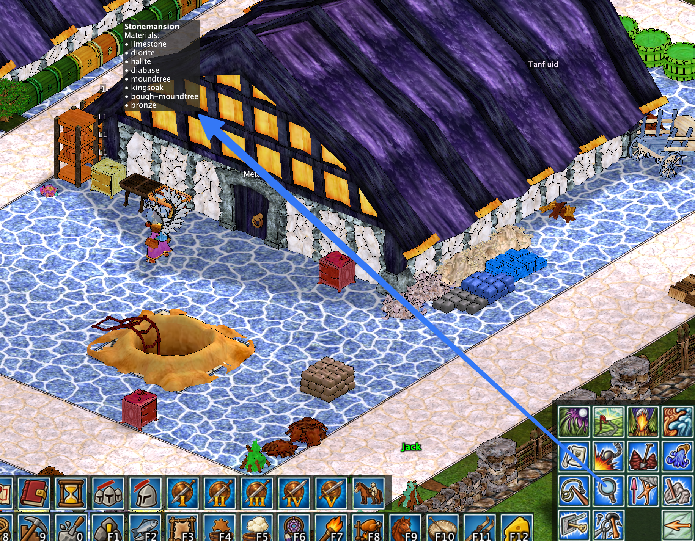
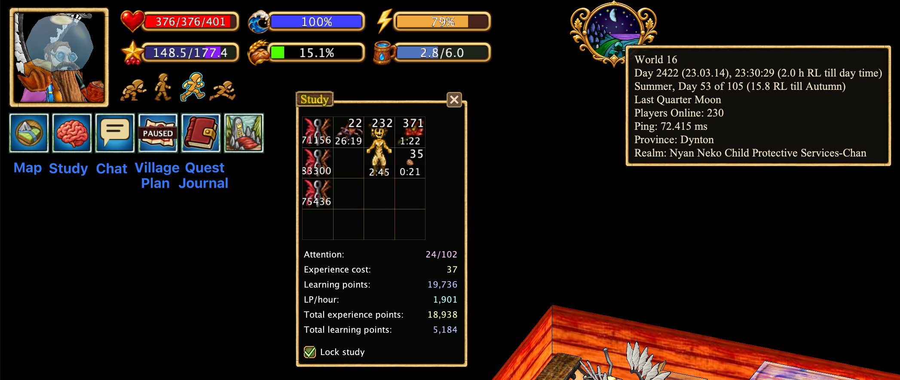
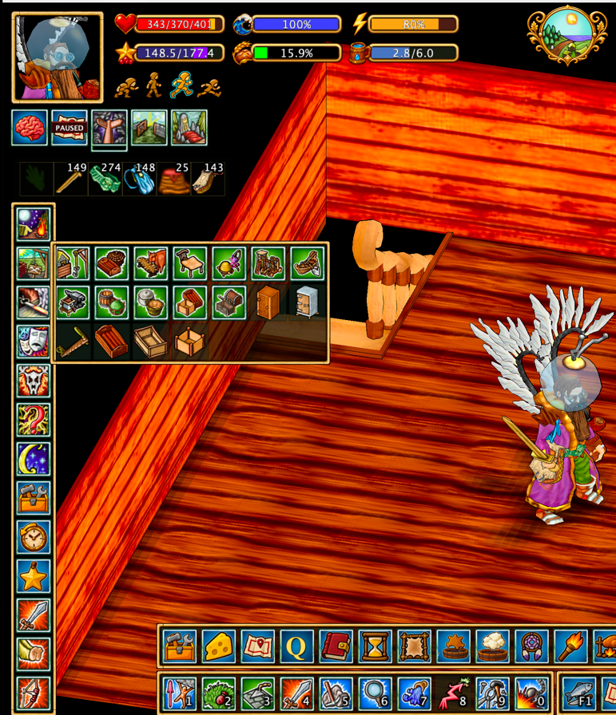
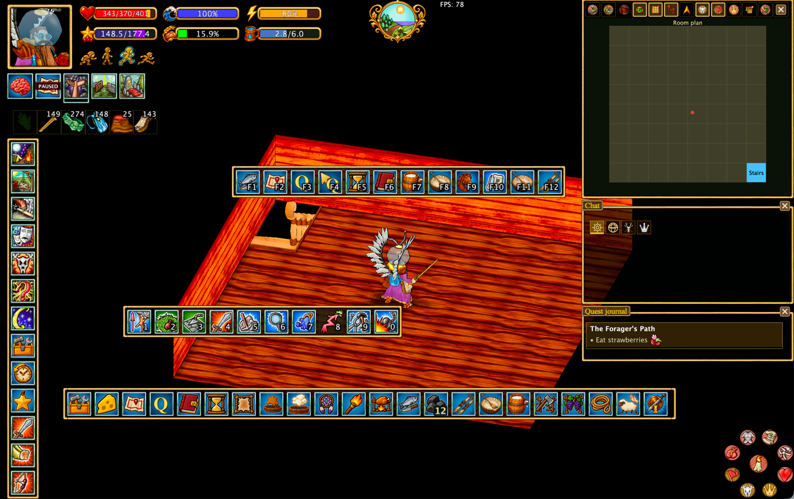
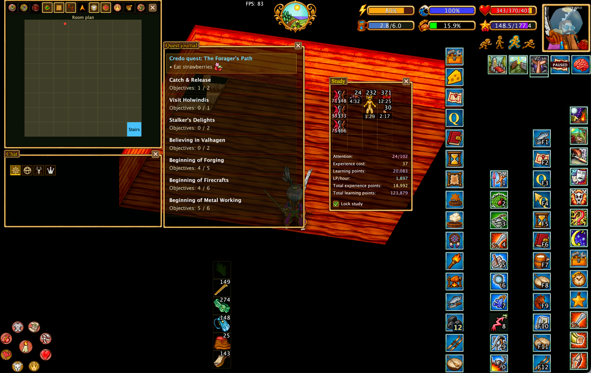
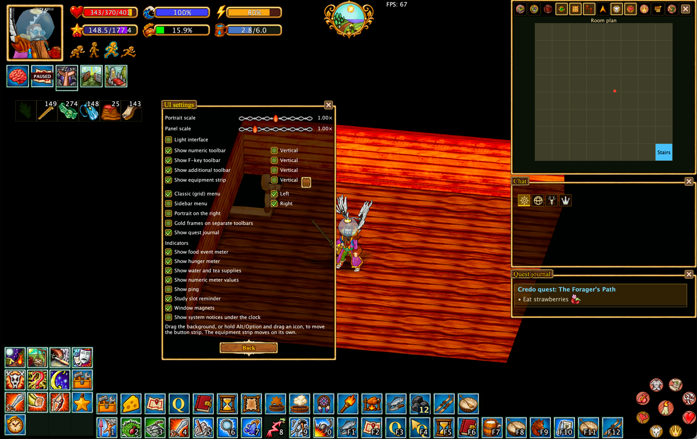
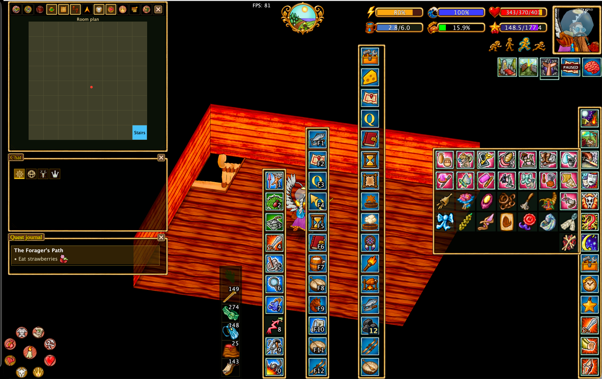
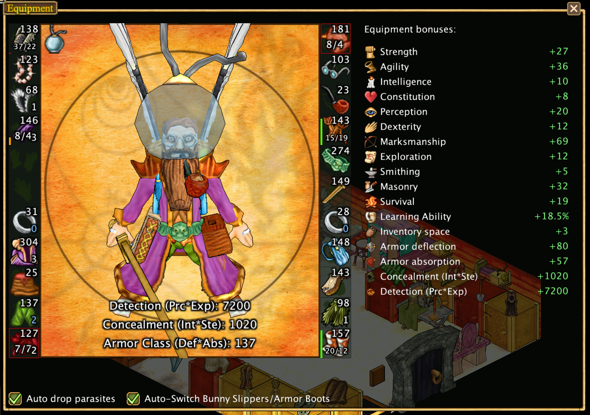
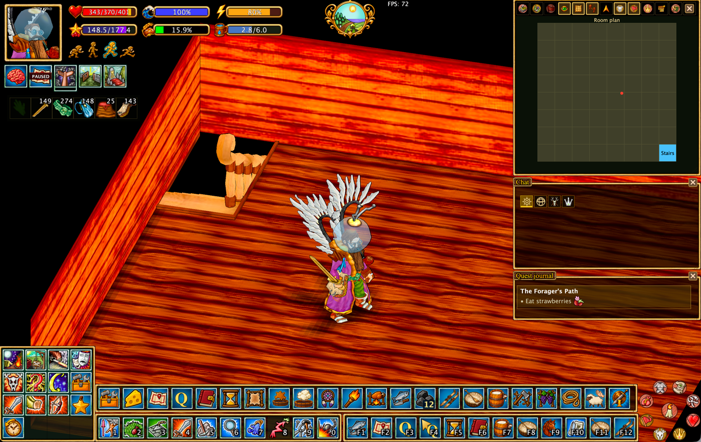
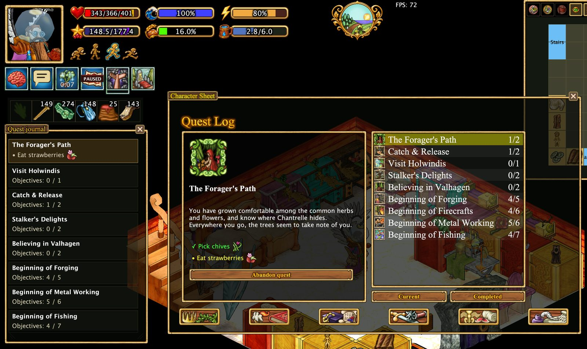

# Redesigned Hearthborn interface

Hearthborn provides a fully configurable in-game interface. You can keep the familiar Haven & Hearth action grid, use an expandable sidebar, and arrange the surrounding panels to suit your screen and play style.

## Enhanced Inspect

The **Inspect** action reveals additional information about objects in the world. For example, inspecting a building can show **which materials were used to construct it**, including the different stone, wood, and metal materials recorded for the structure.

**Hold Shift while inspecting** to display technical information, including the object's **in-game resource name**. This is useful when you need to identify the exact game resource rather than only its visible name.

## Interface widgets

Hearthborn provides compact **widgets** for frequently used windows and information. They keep essential controls accessible without leaving every full-sized window open.

- **Map:** You can close the map completely. A **Map widget** remains available; click it to reopen the map.
- **Chat:** When the chat window is closed, a **Chat widget** appears. An indicator on the widget shows unread messages; click it to open the chat. You can optionally enable **automatic chat opening when a new message arrives** in the settings. **System messages do not count** as new chat messages and do not trigger automatic opening.
- **Study:** A **brain icon** appears when there are free slots in the study window. Click it to open the **compact study window**.
- **Claim Plan:** Click to open the **village or personal claim plan**.
- **Quest Journal:** Click to open the quest journal. **Hover** over the widget to see the active quest and its objectives.
- **Clock:** **Hover** over the clock to see additional world and session information. You can also enable **FPS and server ping indicators** in the settings; they appear **to the right of the clock**.

## Cupboard contents at a glance

Hearthborn displays an **item icon above each cupboard**, automatically choosing the item that is **most common inside**. You only need to **open the cupboard once** for the client to learn its contents. You can also choose a different icon manually in the cupboard's settings and adjust the indicator's size and color.

The same previously observed cupboard information can also be displayed on the **room plan** described below. The room plan does not collect it itself.

## Room plan

The original indoor map showed the current house as a square, with other nearby houses appearing as squares against a black background. Hearthborn replaces that view with a **room plan** in the same map area.

The room plan displays the layout of the current house and can show the **contents of cupboards that have been opened at least once**. This information is not collected by the room plan itself: **a separate script records the cupboard contents**, and the room plan displays the information that was already gathered. Cupboards that have never been opened do not have observed contents to display.

This gives the indoor map a practical purpose: seeing where previously inspected items are stored without opening every cupboard again.

## Hide trees and bushes

Press **Ctrl + H** to hide trees while keeping their **stumps visible**. This makes it easier to see the ground and objects that would otherwise be obscured by foliage, without losing track of where the trees stand.

By default, **Ctrl + H hides trees only**. To hide **bushes as well**, enable the corresponding option in the settings. Bushes do not have their own stumps, so hidden bushes are represented by a **small mulberry-tree stump** instead.

Hearthborn also displays **tree growth stages**, helping you identify how far trees have developed.

**Trees and bushes hidden**

**Trees and bushes visible**

## Choose your action menu

**Classic (grid) menu** preserves the familiar 4×4 action hierarchy and navigation. Position it in either bottom corner.

### Classic menu layouts

The classic menu can sit in the **bottom-left** or **bottom-right** corner, with the portrait and status bars positioned independently.

**Quick return to the main menu:** Instead of pressing Back repeatedly through each submenu, **right-click (RMB) the Back button** to jump directly to the top-level (home) action menu. A normal left-click still returns one level at a time.

**Classic menu on the left**

**Classic menu on the right**

### Sidebar menu

The **Sidebar menu** replaces the grid with a vertical list of action categories. Click a category to expand its actions beside the sidebar; subcategories expand in place. Switch between the two styles in **Options → UI settings**.

## Movable radial menu

The **radial action menu** can be moved around the screen just like the additional toolbars, and **stays where you place it**.

To move it, **drag the gap between buttons** directly, or **hold Alt (Option on Mac) and drag a button**. Dragging a button with Alt/Option held **does not activate that button**.

Until you move the menu, it remains in its **original corner**.

## Arrange your toolbars

F-key, numeric, and additional toolbars can be moved around the screen and arranged horizontally or vertically. Supported bars can also be attached to the bottom edge. Keep them together or separate them to make room for other windows.

Drag a toolbar by its background or gaps between buttons. When an icon occupies the area you need to drag, hold **Alt/Option** while dragging. Action toolbars snap to each other, making it easy to arrange them as a group.

## Position the portrait and status indicators

Move the character portrait and status bars together to the right side if you prefer a mirrored HUD. Surrounding indicators adjust to the new position. Show or hide supported indicators, including food and hunger meters, water and tea, study reminders, FPS/ping, and other utility widgets.

**Character portrait shortcuts:** **Left-click (LMB)** the portrait to open the **Equipment** window. **Right-click (RMB)** the portrait to open the **Character Sheet** window.

**Water and auto-drink:** Click the **water capacity indicator** to drink water manually. You can also enable **Auto-drink** in **Settings** and choose the fatigue threshold at which the character drinks automatically: **25%, 50%, or 75%**.

## Adjust appearance and scale

Use **Options → UI settings** to change panel scale, portrait scale, the option to enable or disable decorative gold frames on supported toolbars, and the light interface option. These settings let you choose between a compact workspace and larger, more accessible controls.

## Redesigned Character Sheet

The **Character Sheet** presents character progression and food-related information in a clearer layout. The **Base Attributes** table shows base values, positive and negative modifiers, and resulting totals side by side. **Food Satiations** lists food types and their current percentages, while **Food Event Points** and **Hunger Level** are displayed as prominent progress bars. The familiar character-sheet category icons remain accessible along the bottom.

## Equipment window and bonuses

The **Equipment** window now includes an **Equipment bonuses** panel, showing the combined bonuses provided by equipped items. It displays bonuses to character attributes and skills, as well as learning ability, inventory space, armor deflection and absorption, **Concealment (Int × Ste)**, and **Detection (Prc × Exp)**. This makes it easier to review equipment effects without inspecting each item separately.

## Quest journal, chat, and equipment

The **Quest journal** is a movable window that keeps active quests and objectives visible. Chat can be repositioned and resized. The equipment strip can be arranged vertically or horizontally, with configurable visible slots. Chat, the quest journal, and the map snap to each other and to the edges of the screen. Action toolbars also snap together.

## Compact interface

Press **Alt+Space** to toggle compact UI. During combat, the client can automatically hide nonessential windows and toolbars to keep the action visible. The shortcut also works outside combat. You can restore the full interface without losing your preferred layout.

**Compact UI:**

**Compact UI in combat:**

## Example layouts

The screenshots above demonstrate different configurations, not fixed presets. You can mix their arrangements to build your own layout.
