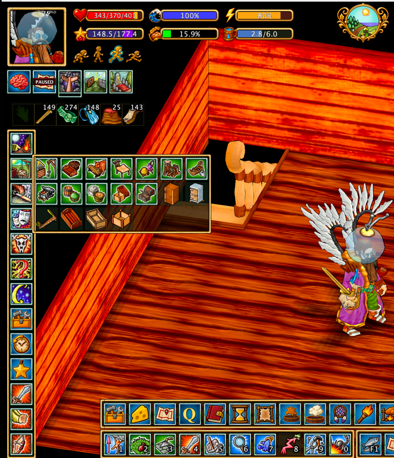
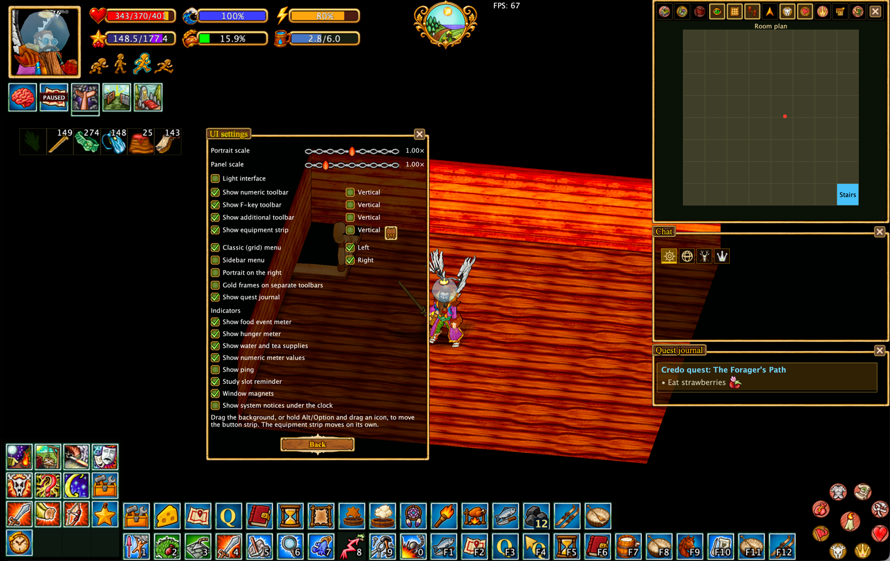

# Настраиваемый интерфейс Hearthborn

Интерфейс можно перестроить под размер экрана и привычный стиль игры.

## Выбор меню действий

**Классическое меню 4×4** сохраняет привычную сетку Haven & Hearth. Его можно разместить в нижнем углу. **Боковое меню** показывает вертикальный список категорий и раскрывает вложенные действия. Переключение находится в **Options → UI settings**.

## Панели быстрого доступа

Панели F-клавиш, цифровые и дополнительные панели можно перемещать, располагать горизонтально или вертикально и закреплять в удобных местах.

## Портрет и индикаторы

Положение портрета, показателей состояния и элементов интерфейса можно адаптировать под правую или левую сторону экрана.

## Оформление и масштаб

Доступны настройки масштаба, светлого и тёмного оформления, декоративных рамок, перетаскивания и магнитного выравнивания окон.

## Журнал заданий, чат и экипировка

Окна журнала заданий, чата и экипировки можно расположить удобнее, не перекрывая основные игровые элементы.

## Компактный режим

**Alt + Space** включает компактный интерфейс, освобождая место на экране.

## Примеры оформления

[Все функции](../index.md#features)
