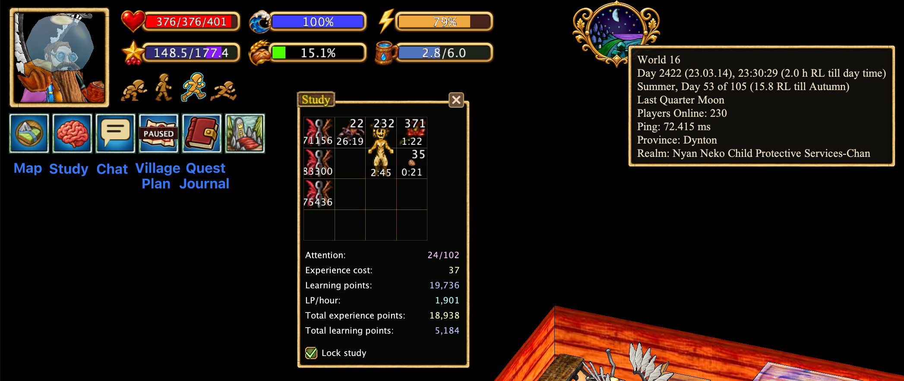

# Настраиваемый интерфейс Hearthborn

Интерфейс можно перестроить под размер экрана и привычный стиль игры.

## Виджеты интерфейса

В Hearthborn есть компактные **виджеты** для часто используемых окон и информации. Они позволяют не держать все полноразмерные окна постоянно открытыми.

- **Карта (Map):** карту можно полностью закрыть. Вместо неё остаётся **виджет карты**; клик по нему снова открывает карту.
- **Чат (Chat):** когда чат закрыт, появляется **виджет чата**. Непрочитанные сообщения отмечаются индикатором на виджете. Клик открывает чат. В настройках можно включить **автоматическое открытие чата при новом сообщении**. **Системные сообщения не считаются** новыми сообщениями чата и не вызывают автоматического открытия.
- **Изучение (Study):** **значок мозга** появляется, если в окне изучения есть свободные слоты. Клик открывает **компактное окно изучения**.
- **План владений (Claim Plan):** клик открывает **план деревенского или личного владения**.
- **Журнал заданий (Quest Journal):** клик открывает журнал. При **наведении** показываются активный квест и его задания.
- **Часы (Clock):** при **наведении** отображается дополнительная информация о мире и игровой сессии. В настройках можно включить **индикаторы FPS и пинга до сервера**; они появятся **справа от часов**.

## Содержимое шкафов с первого взгляда

Hearthborn показывает **значок предмета над каждым шкафом**, автоматически выбирая тот предмет, **которого внутри больше всего**. Достаточно **хотя бы один раз открыть шкаф**, чтобы клиент узнал его содержимое. В настройках шкафа можно вручную выбрать другой значок, а также изменить размер и цвет индикатора.

Эти же ранее полученные сведения о шкафах могут отображаться на **плане дома**, который описан ниже. Сам план данные не собирает.

## План дома

В оригинальном клиенте при входе в дом на месте карты отображался квадрат текущего дома, а на чёрном фоне могли быть видны такие же квадраты соседних домов. Hearthborn заменяет этот вид **планом дома**, который показывается в той же области интерфейса.

На плане видна схема помещения и может отображаться **содержимое шкафов, которые хотя бы раз открывали**. При этом **сам план дома не собирает данные о предметах**: их заранее записывает отдельный скрипт, а план лишь отображает уже полученную информацию. Если шкаф ни разу не открывали, сведений о его содержимом для отображения ещё нет.

Так карта внутри дома становится полезной: можно посмотреть, где лежат ранее обнаруженные предметы, не открывая каждый шкаф заново.

## Скрытие деревьев и кустов

Нажмите **Ctrl + H**, чтобы скрыть деревья. На их месте останутся **видимые пни**. Так листва не перекрывает землю и предметы, но при этом видно, где находятся деревья.

По умолчанию **Ctrl + H скрывает только деревья**. Чтобы одновременно скрывать **кусты**, включите соответствующую опцию в настройках. У кустов нет собственных пней, поэтому скрытые кусты обозначаются **маленьким пеньком шелковицы**.

Hearthborn также отображает **стадии роста деревьев**, чтобы было проще следить за их развитием.

**Деревья и кусты скрыты**

**Деревья и кусты отображаются**

## Выбор меню действий

**Классическое меню 4×4** сохраняет привычную сетку Haven & Hearth. Его можно разместить в нижнем углу. **Боковое меню** показывает вертикальный список категорий и раскрывает вложенные действия. Переключение находится в **Options → UI settings**.

## Панели быстрого доступа

Панели F-клавиш, цифровые и дополнительные панели можно перемещать, располагать горизонтально или вертикально и закреплять в удобных местах.

## Портрет и индикаторы

Положение портрета, показателей состояния и элементов интерфейса можно адаптировать под правую или левую сторону экрана.

## Оформление и масштаб

Доступны настройки масштаба, светлого и тёмного оформления, декоративных рамок, перетаскивания и магнитного выравнивания окон.

## Журнал заданий, чат и экипировка

Окна журнала заданий, чата и экипировки можно расположить удобнее, не перекрывая основные игровые элементы.

## Компактный режим

**Alt + Space** включает компактный интерфейс, освобождая место на экране.

## Примеры оформления

[Все функции](../index.md#features)
