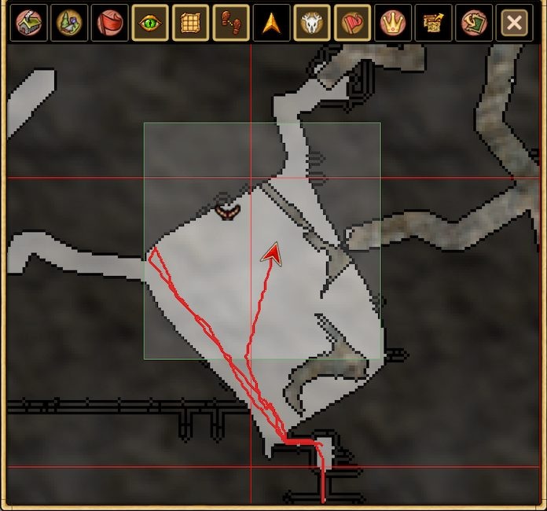

# Session trail

Enable **Show Session Trail** to see the route you have walked directly on the map during your **current play session**. The trail shows where you have traveled since the session began, making it easier to retrace your steps while exploring.

The route is **temporary and is not saved or recorded to disk**. It is not a persistent travel history and does not carry over to another session.

[Back to features](../../README.md#features)
