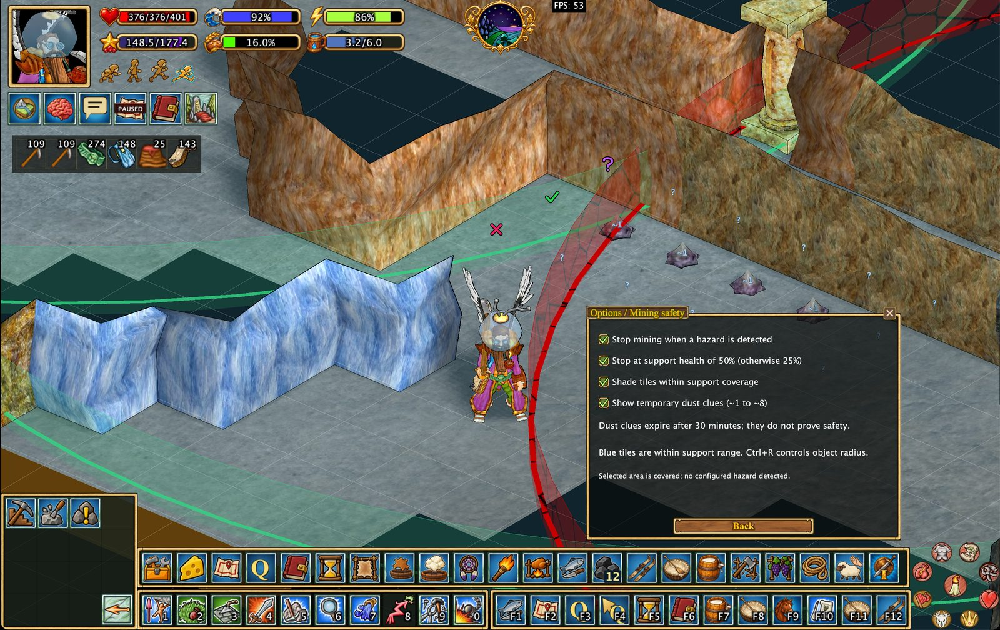

# Mining safety, Minesweeper, and support overlays

Hearthborn adds a **Minesweeper-inspired annotation tool** for cave mining. It combines your own tile markings with dust clues observed from the game, helping you keep track of what you have checked while exploring underground.

The markings are a planning aid, **not a guarantee that a tile is safe to mine**. Hearthborn also has separate mining safety checks for supports and dangerous conditions.

## Minesweeper: enable annotation mode

Open the **Mining** section of the action menu and choose **Minesweeper** to enable the annotation cursor.

While this cursor is active, clicks on cave tiles are used for marking and inspecting clues; they are **not sent to the game server as mining actions**.

Press **Escape** to exit annotation mode. Existing marks remain on the map.

### Place your own marks

**Left-click** a tile to cycle through the four states:

| Mark | Color | Meaning |
| --- | --- | --- |
| ✕ | Red | Your own cross mark |
| ✓ | Green | Your own check mark |
| ? | Purple | Your own question mark |
| Empty | — | Remove your mark |

These symbols represent **your own notes**, not a safety assessment made by the client.

## Automatic dust clues

When the game reports a cave dust warning (`cavewarn`), Hearthborn automatically records a numeric clue for the observed tile.

- Clues range from **1 to 8**, with colors progressing from light blue toward red.
- A temporary clue is displayed with a tilde, such as **`~3`**, and lasts **30 minutes**.
- A clue reports an observation from that tile. It **does not declare the tile safe**.
- Empty neighboring tiles of a visible numeric clue are marked with **?**.

Temporary dust clues are hidden by default. To see them, enable **Settings → Mining Safety → Show temporary dust hints**. With this option disabled, only pinned numeric clues and your own marks are visible.

### Pin or unpin a clue

**Right-click** a tile with a dust number while the Minesweeper cursor is enabled:

- A temporary clue becomes **pinned permanently**.
- Right-clicking the pinned clue again returns it to **temporary** status.
- If there is no dust number on that tile, the client reports that there is nothing to pin.

**Persistence:** Pinned numbers and all manually placed marks are stored in the map file and remain available after restarting the client. Temporary numbers are not retained after leaving the client.

## Inspect neighboring tiles

Hover over a numbered dust clue to highlight its **eight neighboring tiles**. The tooltip shows:

- When dust was observed.
- How many open cave tiles and walls were present at the time.
- Whether the neighboring numbered clues are consistent with one another.

**Matching clues do not prove a tile is safe.** Conditions may change, and these numbers describe observations rather than a definitive mining result.

## Mining safety checks are separate

Hearthborn can independently interrupt mining when it detects supported dangerous conditions, including:

- A broken or damaged mine support.
- Loose or unstable material.
- Mine-support radius and coverage concerns.

Control this behavior with its **separate checkbox in Settings → Mining Safety**.

**Minesweeper does not enable, disable, or depend on the automatic mining stop option.** Turning on annotation mode only changes how the annotation cursor processes clicks.

## Mine-support ranges and overlays

Hearthborn can show mine-support coverage and configurable ranges for supported world objects. You can use these overlays alongside your annotations when planning where to mine.

The coverage display relies on loaded objects and the information currently available to the client. A colored support area or an apparently consistent set of clues should never be treated as a promise of protection against cave-ins.

## Other cave-view options

Use the map's display settings to highlight selected cave terrain and ore types while navigating underground.

---

**In short:** Minesweeper is a way to record what you have observed and mark tiles for later. Automatic mining protection is a different feature with its own setting. Neither one replaces caution when mining.

---

## Original README feature overview

## 💣 Reimagined mining Minesweeper

I've reworked the mining **Minesweeper** tool around how I believe it should work: a practical way to mark cave tiles and interpret dust warnings, rather than a system that pretends to know which tiles are safe.

- **Mark tiles yourself:** Cycle through a red cross, green check, purple question mark, or no mark.
- **Record dust clues automatically:** When the game reports a cave dust warning, the client displays a numbered clue from 1 to 8. Temporary clues expire after 30 minutes; you can pin them to keep them.
- **Inspect nearby tiles:** Hover over a clue to highlight its eight neighboring tiles and review the conditions recorded when the dust appeared.
- **Keep your notes:** Manual marks and pinned clues are saved with the map, while temporary observations disappear when you exit the client.

The Minesweeper annotation cursor keeps marking clicks separate from mining actions. Automatic mining-stop protections remain an independent setting. **Clues help you plan, but they never guarantee that mining is safe.**

[Mining safety and annotations](mining-safety.en.md)
