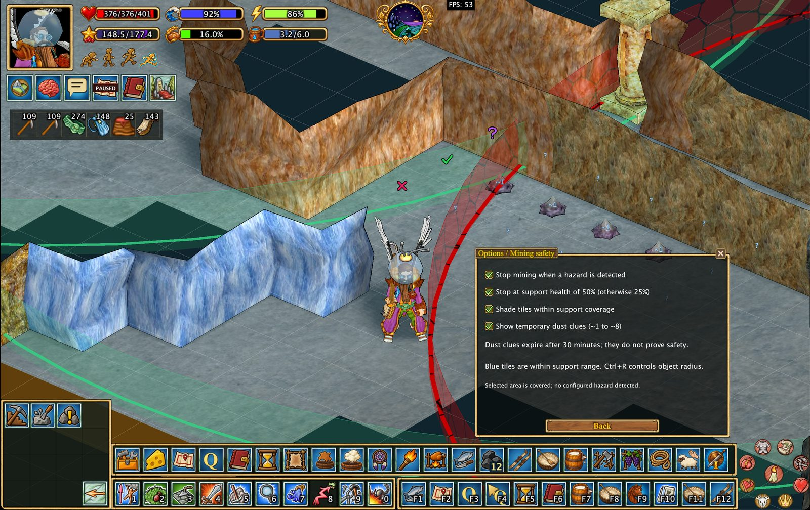

# Безопасность шахт, «Сапёр» и вспомогательные наложения

Hearthborn добавляет инструмент разметки пещерных клеток в стиле **«Сапёра» (Minesweeper)**. Он объединяет ваши собственные отметки с подсказками о пыли, полученными из игры, чтобы помогать отслеживать проверенные участки при исследовании подземелий.

**Чем отличается «Сапёр» Hearthborn:** похожие инструменты существуют в других клиентах Haven & Hearth, но их реализация меня не устраивала. Поэтому я переработал «Сапёр» по собственному принципу: это удобный способ отмечать клетки пещеры и интерпретировать предупреждения о пыли, **а не система, которая якобы знает, где безопасно копать**.

Разметка помогает планировать работу, но **не гарантирует безопасность клетки**. Отдельно Hearthborn предлагает проверки состояния шахтных опор и опасных условий.

## «Сапёр»: включение режима разметки

Откройте раздел **Mining** в меню действий и выберите **Minesweeper**, чтобы включить курсор разметки.

Пока этот курсор активен, щелчки по клеткам пещеры используются для отметок и изучения подсказок; **они не отправляются игровому серверу как действия по добыче**.

Нажмите **Escape**, чтобы выйти из режима. Уже поставленные отметки сохранятся.

### Собственные отметки

**Левый щелчок** по клетке последовательно переключает четыре состояния:

| Отметка | Цвет | Значение |
| --- | --- | --- |
| ✕ | Красный | Ваш собственный крестик |
| ✓ | Зелёный | Ваша собственная галочка |
| ? | Фиолетовый | Ваш собственный вопросительный знак |
| Пусто | — | Удаление отметки |

Это **ваши заметки**, а не оценка безопасности со стороны клиента.

## Автоматические подсказки по пыли

Когда игра сообщает о пещерной пыли (`cavewarn`), Hearthborn автоматически записывает числовую подсказку для наблюдавшейся клетки.

- Значения подсказок: **от 1 до 8**, цвета меняются от светло-голубого к красному.
- Временная подсказка отображается с тильдой, например **`~3`**, и действует **30 минут**.
- Подсказка описывает наблюдение в этой клетке и **не означает, что клетка безопасна**.
- Пустые соседние клетки рядом с видимой числовой подсказкой помечаются знаком **?**.

По умолчанию временные подсказки скрыты. Чтобы их видеть, включите **Settings → Mining Safety → Show temporary dust hints**. Если настройка выключена, отображаются только закреплённые числа и ваши отметки.

### Закрепление и открепление подсказки

**Правый щелчок** по клетке с числом пыли при активном курсоре «Сапёра»:

- Временная подсказка **закрепляется навсегда**.
- Повторный правый щелчок возвращает её во **временное** состояние.
- Если числа пыли в клетке нет, клиент сообщает, что закреплять нечего.

**Сохранение:** закреплённые числа и все ручные отметки записываются в файл карты и остаются после перезапуска клиента. Временные числа при выходе из клиента не сохраняются.

## Изучение соседних клеток

Наведите курсор на числовую подсказку о пыли, чтобы подсветить **восемь соседних клеток**. Во всплывающей подсказке отображается:

- Когда была замечена пыль.
- Сколько открытых клеток пещеры и стен было в тот момент.
- Согласуются ли между собой числовые подсказки соседних клеток.

**Совпадающие подсказки не доказывают безопасность клетки.** Условия могут измениться, а числа описывают наблюдения, а не окончательный результат добычи.

## Проверки безопасности шахты работают отдельно

Hearthborn может независимо прервать добычу при обнаружении поддерживаемых опасных условий, включая:

- Сломанную или повреждённую шахтную опору.
- Рыхлый или нестабильный материал.
- Проблемы с радиусом и зоной действия шахтных опор.

Это поведение управляется **отдельным флажком в Settings → Mining Safety**.

**«Сапёр» не включает, не отключает и не требует автоматической остановки добычи.** Режим разметки меняет только обработку щелчков курсором.

## Радиусы шахтных опор и наложения

Hearthborn может показывать зоны действия шахтных опор и настраиваемые радиусы поддерживаемых объектов мира. Эти наложения можно использовать вместе с отметками при планировании добычи.

Отображение зон зависит от загруженных объектов и сведений, доступных клиенту. Цветная зона опоры или согласующиеся подсказки **не гарантируют защиту от обвала**.

## Другие настройки отображения пещер

В настройках отображения карты можно включить подсветку выбранных типов пещерной местности и руд при перемещении под землёй.

---

**Кратко:** «Сапёр» позволяет записывать наблюдения и отмечать клетки на будущее. Автоматическая защита при добыче — отдельная функция с собственной настройкой. Ни одна из них не заменяет осторожность в шахте.
