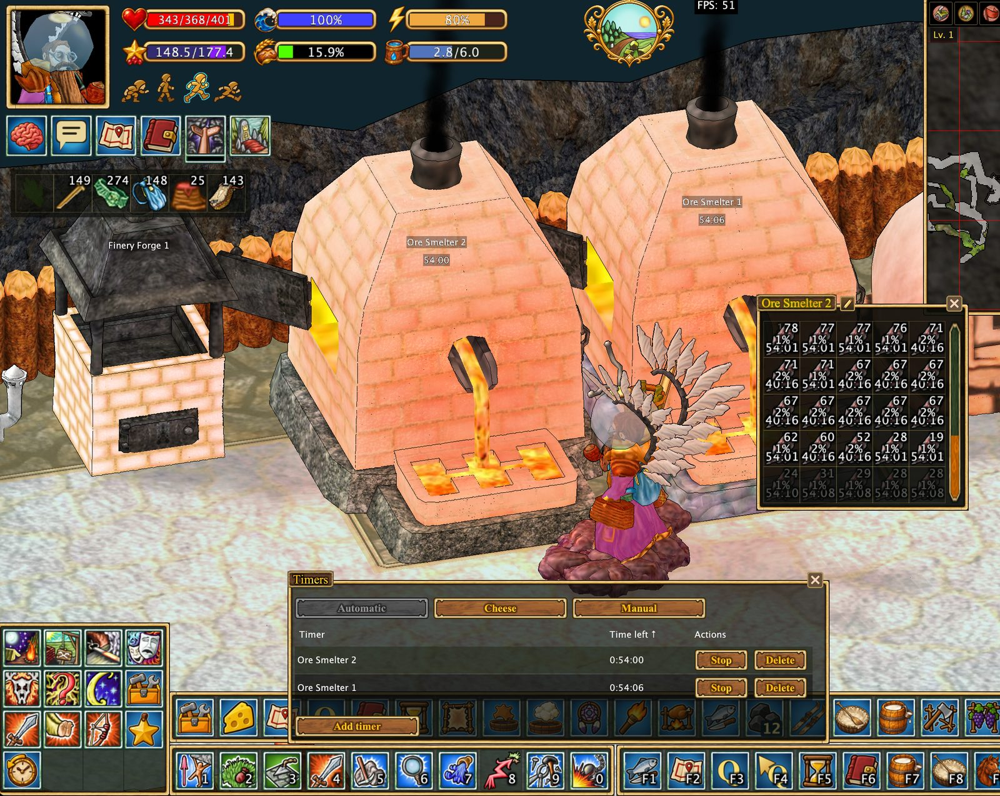

# Производственные инструменты

## Помощник сыровара

Отслеживание стадий сыров из коровьего, овечьего и козьего молока, подписи стеллажей и таблица созревания.

[Подробное руководство](cheese.md)

## Автоматические таймеры

Отслеживание плавилен, печей, горнов, сыров, шёлка, осадных сооружений и других процессов. Есть автоматические и ручные таймеры.

[Подробное руководство](timers.md)

## Хранилища и склады

Значки содержимого над шкафами, обозначения складов руды и цветов материалов.

[Подробное руководство](storage.md)

Информация отражает данные, наблюдаемые клиентом.

[Все функции](../index.md#features)
