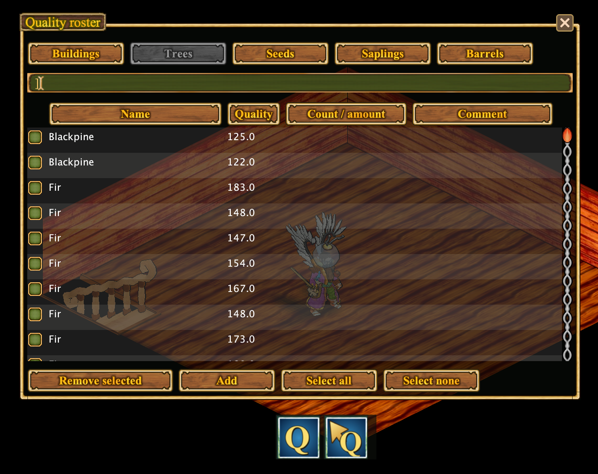

# Quality Roster

The **Quality Roster** keeps a journal of quality values observed on objects and resources.

## Two Q actions

- **Q:** Open the Quality Roster and browse recorded entries, including buildings, trees, seeds, saplings, and barrels.
- **Q with an arrow:** Activate the quality-recording cursor. Select an object to read its quality and record it in the journal.

## Quality on plans

Recorded quality values can also appear on the **Village Plan** or **Personal Claim Plan**, allowing you to identify useful trees and production equipment in context. A plan cannot show quality that has not been recorded.

[Village and claim planning](claim-plan.en.md) · [Back to features](../../README.md#features)

---

## Original README feature overview

## 🏡 Village and claim planning

Keep a locally saved overview of visited village and personal-claim areas. Find and label observed objects, measure areas in tiles, switch levels, and export plans to HTML or Excel.

| # | Feature | How it appears in the plan |
| --- | --- | --- |
| **1** | **Named areas** | Add an area and give it a useful name, such as *Leather Storage*, to mark where hides or other materials are kept. |
| **2** | **Named houses** | Rename a house in the plan. The same name also appears above the house in the game world. |
| **3** | **Tree quality** | Trees recorded in the **Quality Journal** display their known quality on the plan. |
| **4** | **Furnaces and smelters** | Production equipment is added to the plan automatically. Its quality is displayed when that value is recorded in the **Quality Journal**. |
| **5** | **Village idol** | The village idol is shown as part of the settlement layout. |
| **6** | **Chicken coops and rabbit hutches** | Animal-keeping structures are represented on the plan. |
| **7** | **Tanning tubs** | Leather-processing tubs appear in their observed locations. |
| **8** | **Drying racks** | Leather drying racks are shown as part of the production area. |

[Learn about village and claim plans](claim-plan.en.md)
