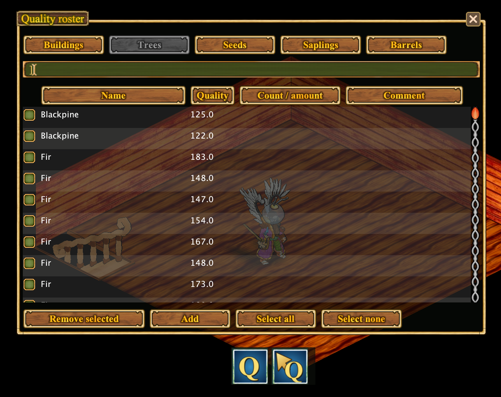

# Журнал качества

**Quality Roster** хранит сведения о качестве обнаруженных объектов и ресурсов, чтобы их не приходилось запоминать.

## Два действия Q

- Кнопка **Q** открывает журнал качества.
- Действие с **Q и стрелкой** записывает качество выбранного объекта, когда информация доступна.

## Качество на планах

Известные значения качества могут отображаться на планах деревни и владений. Это удобно при работе с деревьями, печами и другими производственными объектами.

Журнал не определяет качество объектов, которые клиент ещё не исследовал.

[Все функции](../index.md#features)
