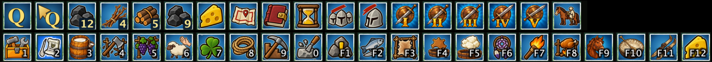
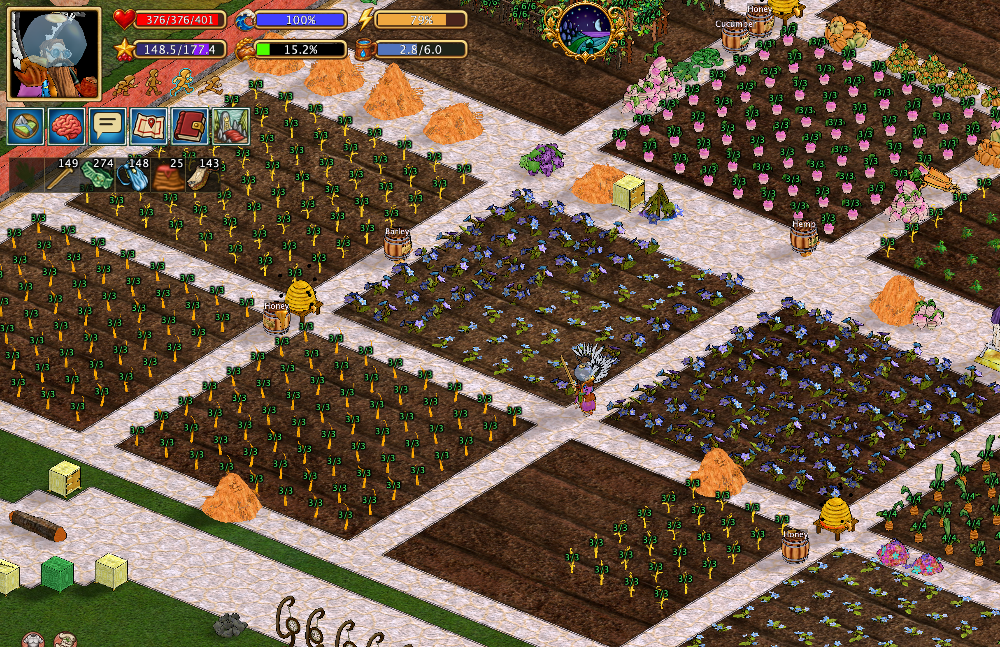

# Скрипты автоматизации и повседневные помощники

Hearthborn содержит небольшие специализированные команды в меню действий. Они автоматизируют повторяющиеся взаимодействия с ближайшими объектами, предметами инвентаря, животными и растениями. Это **отдельные команды**, а не система, самостоятельно выполняющая всю производственную цепочку.

Меню **Xtensions** также включает действия для путешествий, шахт и размещения походного снаряжения. Ниже описаны команды для производства, земледелия, животных и повседневных взаимодействий.

## Стадии роста культур

Hearthborn может показывать **стадию роста растений на полях** непосредственно над ними.

По умолчанию индикаторы видны **только над культурами, готовыми к сбору**, чтобы не загромождать экран. **Удерживайте Shift**, чтобы временно показать стадии роста **ещё не созревших растений**.

## Перед запуском

- Убедитесь, что необходимые предметы, инструменты и ближайшие объекты доступны согласно описанию команды.
- **Escape** останавливает **следующие шаги** скрипта. Уже выполненные действия и отправленные игре изменения не отменяются.
- Команда не создаёт недостающие ресурсы и не обходит требования игры. Она выполняет только описанные действия.

## Топливо и растопка

### Добавить пять брёвен

Добавляет **пять брёвен** в поддерживаемый ближайший объект. Перед запуском подготовьте брёвна. Это загрузка топлива, **а не розжиг**: огонь команда не зажигает.

### Добавить четыре ветки в печь

Кладёт **четыре ветки** в **ближайшую печь**. Ветки берутся **только из основного инвентаря**: другие контейнеры и хранилища не проверяются.

Команда **не разжигает** печь. **Escape** останавливает оставшиеся шаги, но уже добавленные ветки остаются внутри.

### Добавить девять единиц угля в плавильню

Загружает **девять единиц угля** из **основного инвентаря** в плавильню. Команда предназначена для плавилен, **не для коптилен**.

Она **не разжигает** плавильню и не берёт уголь из других хранилищ. **Escape** отменяет только дальнейшие шаги.

### Добавить двенадцать единиц угля в плавильню

Загружает **двенадцать единиц угля** из **основного инвентаря** в плавильню. **Коптильни не поддерживаются**.

Как и команда для девяти единиц угля, эта команда **не разжигает** плавильню. **Escape** останавливает только последующие действия.

**Команды загрузки топлива не разжигают огонь.** При необходимости используйте отдельную команду розжига факелом.

## Производственные станции

### Собрать готовое с сушилок

Собирает готовое содержимое сушилок в **уже загруженной окружающей области**.

**Shift + та же команда** вместо сбора развешивает **сырые шкуры** на сушилках. Команда не ищет объекты в незагруженных областях и не гарантирует, что каждая сушилка готова или доступна. **Escape** останавливает оставшиеся операции, не возвращая собранные предметы и не снимая уже развешенные шкуры.

### Собрать готовую кожу

Собирает готовую кожу из дубильных чанов.

**Shift + та же команда** вместо сбора помещает в чаны **высушенные шкуры**. Команда не сушит шкуры и не завершает дубление мгновенно. **Escape** предотвращает дальнейшие действия, но не отменяет выполненные переносы.

### Заполнить сырные формы

Заполняет **открытые пустые сырные формы** творожной массой. Требуется **как минимум четыре единицы одного и того же вида массы**.

Если **на курсоре появляется другой вид массы**, скрипт останавливается. Он не смешивает разные виды, не открывает закрытые формы автоматически и не создаёт недостающие ингредиенты. **Escape** останавливает дальнейшее заполнение, не опустошая уже заполненные формы.

### Разжечь факелом

Берёт **зажжённый факел из руки персонажа**, поджигает ближайший поддерживаемый объект и возвращает факел на прежнее место.

Поддерживаются ближайшие **печь, плавильня, тигель, обжиговая печь и котёл**. Команда не создаёт и не зажигает потухший факел, не добавляет топливо и не запускает другие производственные этапы. **Escape** отменяет дальнейшие шаги, но не тушит уже разожжённый огонь.

### Разделать рыбу

Обрабатывает рыбу в инвентаре, пока не останется рыбы для разделки.

Команда не добывает дополнительную рыбу из мира или хранилищ. **Escape** останавливает дальнейшую обработку; уже разделанная рыба остаётся разделанной.

## Животные и растения на шпалерах

### Собрать ближайшее растение со шпалеры

Собирает **ближайшее созревшее растение на шпалере**. Незрелые растения не собираются, урожай автоматически не перерабатывается.

**Escape** останавливает дальнейшие действия, но не отменяет уже выполненный сбор.

### Уничтожить ближайшее растение на шпалере

Удаляет **ближайшее растение на шпалере**, а не собирает урожай. Это отдельная команда.

Уничтоженные растения не восстанавливаются. **Escape** предотвращает только дополнительные действия.

### Прогнать ближайшее животное

Прогоняет ближайшее **неподвижное** поддерживаемое животное: **лошадь, овцу, корову, свинью или козу**.

Движущиеся животные и другие виды не поддерживаются. **Escape** останавливает оставшиеся действия, но не возвращает уже прогнанное животное.

### Клевер

Кормит клевером **неподвижное животное, которое можно приручить**. Команда не приручает любых животных автоматически и не преследует движущуюся цель.

**Escape** останавливает дальнейшие действия, не отменяя уже выполненное кормление.

### Верёвка

Берёт верёвку из **инвентаря** и оставляет её **на курсоре** для дальнейшего использования игроком.

Команда не привязывает верёвку к животному автоматически и не возвращает её в инвентарь. **Escape** останавливает дальнейшие шаги, но не обязательно убирает предмет с курсора.

### Позвать лошадь и сесть верхом

Подзывает лошадь и садится на неё. Если лошадь **далеко**, персонаж сначала **свистит**.

Команда **не запускается**, если персонаж уже верхом или находится в лодке. Нет гарантии, что недоступная лошадь придёт. **Escape** останавливает оставшиеся шаги, но не отменяет уже выполненный свист или посадку.

### Спешить всадника

Использует **ближайшую неподвижную лошадь** для действия по спешиванию всадника.

Команда не ищет движущихся лошадей или удалённые цели. **Escape** отменяет дальнейшие шаги, но не уже выполненное действие.

## Другие повседневные помощники

### Собрать молоко и сообщить качество

Собирает молоко и сообщает качество полученного молока. Значение относится к выполненному сбору, а не к прогнозу качества будущего молока.

### Собрать сны

Собирает сны из ближайших ловцов снов. Работает с доступными клиенту объектами в окружающей области, а не с объектами в других частях мира.

## Ограничения и отмена

У каждого помощника свои требования к инвентарю, целям и состоянию объектов. В частности, **команды загрузки топлива** используют указанный источник предметов и не разжигают огонь; **сушилки и дубильные чаны** имеют отдельные режимы сбора и загрузки через **Shift**; а **сырные формы** требуют одинаковую массу и открытые пустые формы. Подробности приведены в соответствующих разделах.

Помощники работают с доступными, наблюдаемыми игровыми объектами. Успех не гарантируется, если цель движется, инвентарь меняется или игровые условия препятствуют действию.

**Escape останавливает только будущие шаги.** Это не отмена уже переложенных предметов, загруженного топлива, собранного урожая, зажжённого огня или других выполненных действий.

**Журнал заданий, учёт животных, боевые школы и сброс урона** — отдельные интерфейсы или возможности, **не скрипты, описанные на этой странице**.
