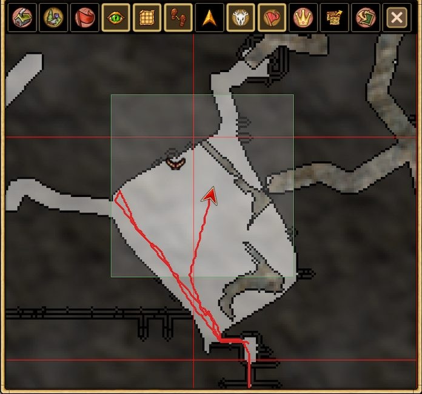

# Маршрут сессии

Включите **Show Session Trail**, чтобы видеть непосредственно на карте путь, пройденный за **текущую игровую сессию**. Маршрут показывает, где вы побывали с начала сессии, и помогает возвращаться по собственным следам во время исследования.

Маршрут **временный и не сохраняется на диск**. Это не постоянная история перемещений; в следующую сессию он не переносится.

[Назад к возможностям](../../README.md#features)
