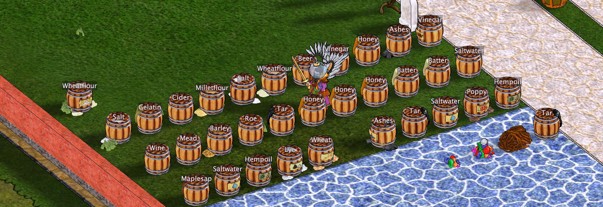

# Storage and production visibility

## Cupboard contents at a glance

A cupboard automatically displays an icon of the **item it contains the most of**, so you can see its main contents without opening it. **You must open the cupboard at least once for this feature to work**, so the client can observe its contents. If you prefer a different icon, you can **choose your own item icon in the cupboard's settings**.

## Barrel contents labels

Hearthborn displays the **contents of barrels as labels above them**.

The game server does not provide the barrel's contents automatically. Until you inspect a barrel, the client can only tell whether it is **empty or full**; **empty barrels are highlighted in orange**.

**Open a barrel at least once during the current session** to let Hearthborn identify its contents and show the corresponding label above it. The information is based on what the client has actually observed, rather than hidden server data.

- Identify observed stone, clay, brick, metal, and ore stockpiles visually. **Stone, brick, and clay stockpiles use distinct colors** to make materials easier to distinguish.
- **Hold Space** to display the names of rock stockpiles.
- Show cheese rack labels, selected object radii, and useful production information in the world.

## Ready-to-collect tanning equipment

**Drying racks for hides** and **tanning tubs** are **highlighted in green when their contents are ready to collect**. This makes it easier to spot completed processing without checking each rack or tub individually.

## Item transfers and stockpile controls

Hearthborn adds shortcuts for moving matching items while keeping different materials separate when needed.

| Action | Shortcut | Result |
| --- | --- | --- |
| Drop one item on the ground | **Ctrl + left-click** the item | Drops only the clicked item. |
| Drop all identical items | **Ctrl + Alt + left-click** the item | Drops that item and all items matching both its **name and resource**. |
| Deposit everything a stockpile accepts | **Shift + left-click** the stockpile | Uses the stockpile's server-side action to take all accepted items from your inventory. Different stone types may be mixed. |
| Deposit only the held stack | Pick up a stack onto the cursor and click the stockpile normally | Deposits only the held stack; other stone types in your inventory remain. |
| Deposit only items with the exact same name into a stockpile | **Shift + Ctrl + right-click** the stockpile | Before depositing, checks the exact item name to avoid mixing different types of stone. |
| Transfer matching items into an open container | **Shift + Ctrl + click** an item (default shortcut) | Transfers items with the same name from the same inventory or bag. **Left-click** starts with the highest quality; **right-click** starts with the lowest. |
| Fill a feeding trough | **Shift + left-click** the trough | The server takes all suitable seeds from your inventory in one action. |

### Transferring items from stacks

**Stacked items can be transferred directly**, including ore stored in stacks inside your inventory or bag. When you click a stack to transfer its contents to another container or a production station, such as an **ore smelter or oven**, Hearthborn handles the items inside the stack.

If the destination **cannot accept a stack as a single object**, Hearthborn automatically takes the individual items out of the stack and transfers them to the destination. You do not need to unpack the stack manually first.

### Why exact-name stockpile deposits matter

A stockpile decides what it accepts and does not distinguish between types of stone: two different kinds of stone can end up mixed in the same pile. Use **Shift + Ctrl + right-click on the stockpile** when you want to deposit only one exact item name instead of letting the stockpile take everything it accepts.

For container transfers, the client only selects matching item names from the **same inventory or bag**. An open chest, cupboard, or table can receive the transfer. Different items, such as granite and basalt, are not transferred together. You can change the shortcut in **Keyboard Settings → “Transfer identical items (with click)”**.

### Other production interactions

**Tar kiln:** Right-click the kiln and choose **Collect coal** to collect all finished coal in one action. If it is the only menu option, **Ctrl + right-click** can select it immediately when **“Ctrl selects a single menu option”** is enabled in the menu color settings.

**Grain barrel:** **Shift + left-click** transfers only the clicked grain stack. **Shift + Ctrl + left-click** transfers all grain stacks with the same name, provided the barrel is open and the server accepts the transfer. For a reliable single-stack transfer, pick up the stack onto the cursor and **right-click the barrel**: only the held stack is deposited.

[Back to features](../../README.md#features)
