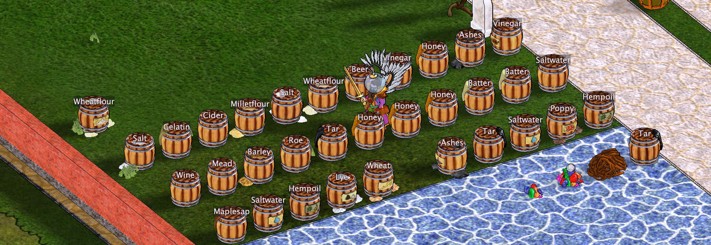

# Хранилища и производство

## Содержимое шкафа с первого взгляда

Над шкафом автоматически отображается **картинка предмета, которого в нём больше всего**. **Чтобы функция заработала, необходимо хотя бы один раз открыть шкаф**, чтобы клиент получил информацию о его содержимом. Так можно сразу понять, что преимущественно хранится в шкафу, не открывая его. При желании **в настройках шкафа можно выбрать свою картинку предмета** вместо автоматически определённой, а также **изменить размер и цвет отображаемого значка**.

Hearthborn позволяет быстрее понять, что хранится в предметах и складах, не открывая их по одному.

## Подписи содержимого бочек

Hearthborn показывает **содержимое бочек в виде подписей над ними**.

Игровой сервер не передаёт клиенту информацию о содержимом бочки автоматически. До открытия можно определить только, **пуста бочка или полна**. **Пустые бочки подсвечиваются оранжевым цветом**.

Чтобы над бочкой появилась подпись её содержимого, **откройте её хотя бы один раз в текущей игровой сессии**. Клиент отображает только ту информацию, которую уже получил при открытии, а не скрытые данные сервера.

- **Склады руды:** значки помогают различать содержимое.
- **Камень, кирпич и глина:** могут использоваться разные цвета и обозначения. **Различение цветов по материалам можно отключить** в настройках.
- **Пустые и полные контейнеры:** можно включить **подсветку по степени заполнения**, чтобы сразу видеть их состояние.
- **Пробел (Space):** удерживайте, чтобы показать названия складов камня.
- **Сырные стеллажи:** подписи помогают отслеживать продукцию.

Отображается только содержимое, о котором клиент располагает сведениями.

## Готовые шкуры и дубильные чаны

**Сушилки для шкур** и **дубильные чаны** **подсвечиваются зелёным цветом, когда содержимое готово к сбору**. Так можно сразу увидеть, где обработка завершена, не проверяя каждую сушилку или чан по отдельности.

## Перекладывание предметов и работа со складами

Hearthborn добавляет сочетания клавиш для быстрого переноса одинаковых предметов и разделения разных материалов.

| Действие | Сочетание | Результат |
| --- | --- | --- |
| Выбросить один предмет на землю | **Ctrl + левая кнопка** по предмету | Выбрасывается только выбранный предмет. |
| Выбросить все точно такие же предметы | **Ctrl + Alt + левая кнопка** по предмету | Выбрасываются предмет и все совпадающие с ним **по имени и ресурсу**. |
| Положить в склад всё подходящее | **Shift + левая кнопка** по самому складу | Сервер забирает из инвентаря всё, что склад принимает. Разные виды камня могут перемешаться. |
| Положить только взятую стопку | Взять стопку на курсор и обычным кликом положить в склад | Переносится только эта стопка, остальные виды камня остаются в инвентаре. |
| Положить в склад только предметы с точным именем | **Shift + Ctrl + правая кнопка** по складу | Перед переносом проверяется точное имя предмета, чтобы не смешивать разные виды камня. |
| Переложить однотипные предметы в открытый контейнер | **Shift + Ctrl + клик** по предмету (по умолчанию) | Переносятся предметы с тем же именем из того же инвентаря или сумки. **Левая кнопка** начинает с лучшего качества, **правая** — с худшего. |
| Заполнить кормушку | **Shift + левая кнопка** по самой кормушке | Сервер за один клик забирает все подходящие семена из инвентаря. |

### Перекладывание предметов из стаков

**Предметы можно перекладывать прямо из стаков**, например руду, сложенную в стак в инвентаре или сумке. При клике по стаку для переноса в другой контейнер или производственный объект, например **плавилку или печь**, Hearthborn обрабатывает предметы внутри стака.

Если место назначения **не принимает стак целиком**, клиент автоматически достаёт предметы из стака по отдельности и перекладывает их. Вручную распаковывать стак перед переносом не требуется.

### Почему для склада нужна проверка точного имени

Склад сам определяет, какие предметы принимает, и не различает виды камня: два разных камня могут оказаться в одной куче. Если нужно положить **только определённый вид камня**, зажмите **Shift + Ctrl** и нажмите **правую кнопку по складу**. Клиент проверит точное имя предмета перед переносом.

При переносе в контейнер выбираются предметы с одинаковым именем **из того же инвентаря или сумки**. Открытый сундук, шкаф или стол может их принять. Гранит не переносится вместе с базальтом. Сочетание можно изменить в **настройках клавиатуры → «Переложить однотипные предметы (с кликом)»**.

### Однотипные предметы: инвентарь и сумки

**Shift + Ctrl + клик** переносит все предметы с тем же именем **из того инвентаря или сумки, где выполнен клик**. **Левая кнопка** начинает с лучшего качества, **правая** — с худшего. Сочетание меняется в **настройках клавиатуры → «Переложить однотипные предметы (с кликом)»**.

Из **сумки** в открытый сундук, шкаф или ящик предметы переносятся **по одному**: сервер не умеет самостоятельно забирать их из сумки. При клике по **стопке в основном инвентаре** переносится и её содержимое, а не только верхняя иконка.

### Кнопка Take в окне стокпайла

В нижней части окна стокпайла есть поле количества и кнопка **Take**. **Пустое поле или 0** забирает всё; **положительное число** — ровно указанное количество, если оно доступно.

**Колесо мыши над кучей** по-прежнему кладёт или забирает **по одному предмету**. **Shift + колесо** перемещает предметы пачкой.

### Кнопки инвентаря и группы предметов

- **Stack** собирает одинаковые предметы в стопки; **Unstack** раскладывает их.
- **Sort:** **левая кнопка** сортирует от лучшего качества к худшему, **правая** — от худшего к лучшему. **Крупные предметы остаются на месте**.
- **Список групп справа:** **левая кнопка** берёт лучший предмет группы, **Shift + левая** переносит его, **Ctrl + левая** выбрасывает, **правая** открывает действие.

### Основной инвентарь: выборочное выбрасывание

**Кнопка сброса** включает выбрасывание выбранных типов предметов. **Правая кнопка по ней** открывает список типов. **Качество при выбрасывании не учитывается**.

**Перед сортировкой, работой со стопками и переносом однотипных предметов курсор должен быть пустым.**

### Другие действия с производственными объектами

**Смоляная печь:** нажмите **правой кнопкой** по печи и выберите **«Собрать уголь»**, чтобы собрать весь готовый уголь одним действием. Если это единственный пункт меню, **Ctrl + правая кнопка** выберет его сразу при включённой настройке цветов меню **«Ctrl selects a single menu option»**.

**Зерно в бочку:** **Shift + левая кнопка** переносит только ту стопку зерна, по которой кликнули. **Shift + Ctrl + левая кнопка** переносит все стопки зерна с тем же именем, но только если бочка открыта и сервер разрешает перенос. Для надёжного переноса одной стопки возьмите её на курсор и нажмите **правой кнопкой по бочке**: переместится только то, что находится на курсоре.

[Все функции](../index.md#features)
