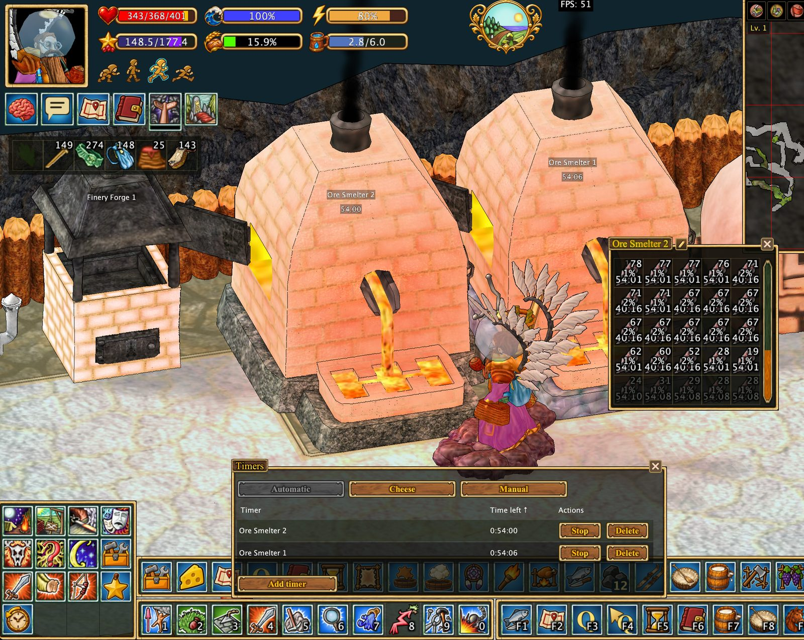

# Автоматические таймеры

Клиент создаёт таймеры для поддерживаемых процессов после соответствующих игровых действий.

## Что отслеживается

- Плавильни, печи, обжиговые печи и кузнечные горны.
- Топливо и процессы в стальном тигле.
- Созревание сыров.
- Шёлк и столы травника.
- Осадные сооружения, включая таран.
- События, связанные с личным владением.

## Вкладки

**Automatic** содержит автоматически созданные таймеры, **Cheese** предназначена для сыров, а **Manual** позволяет добавлять собственные напоминания.

Точность зависит от наблюдений и доступной клиенту информации. Таймеры не выполняют действия за игрока.

[Все функции](../index.md#features)
