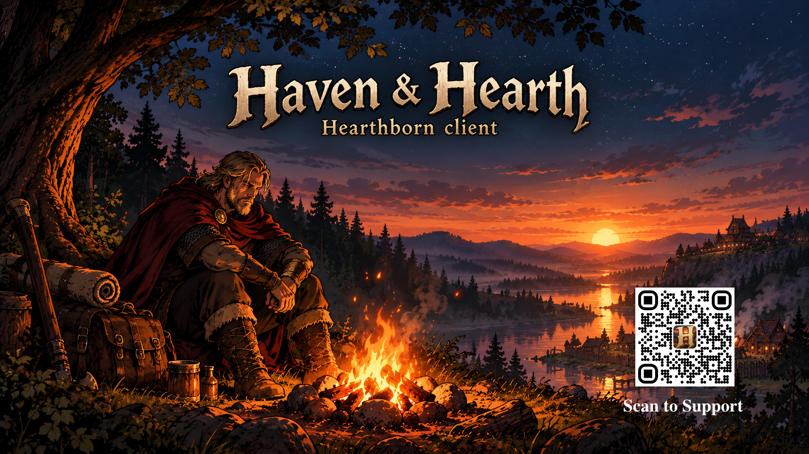
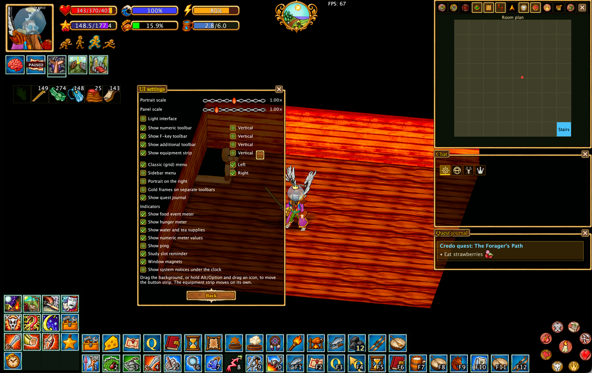
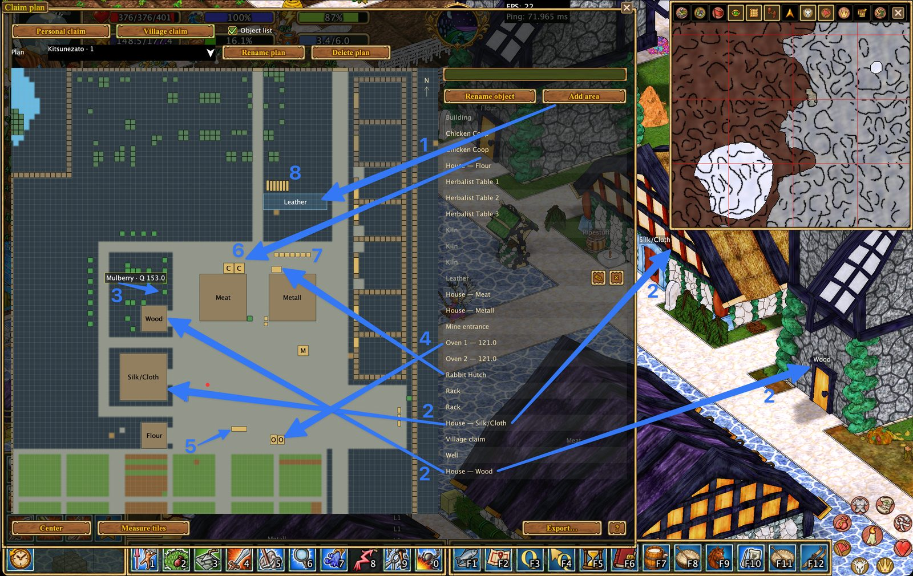
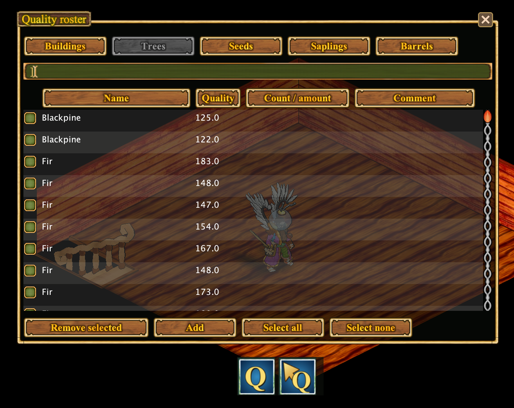
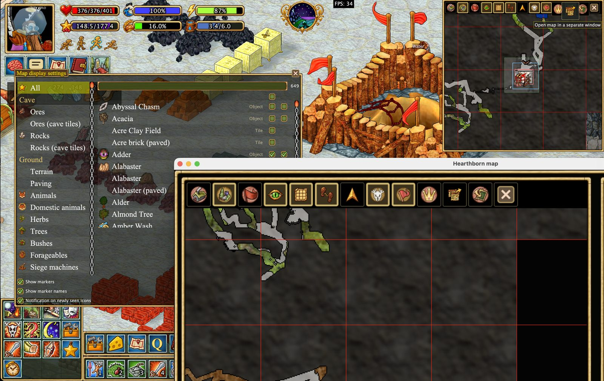
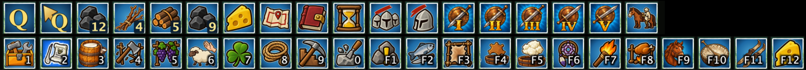
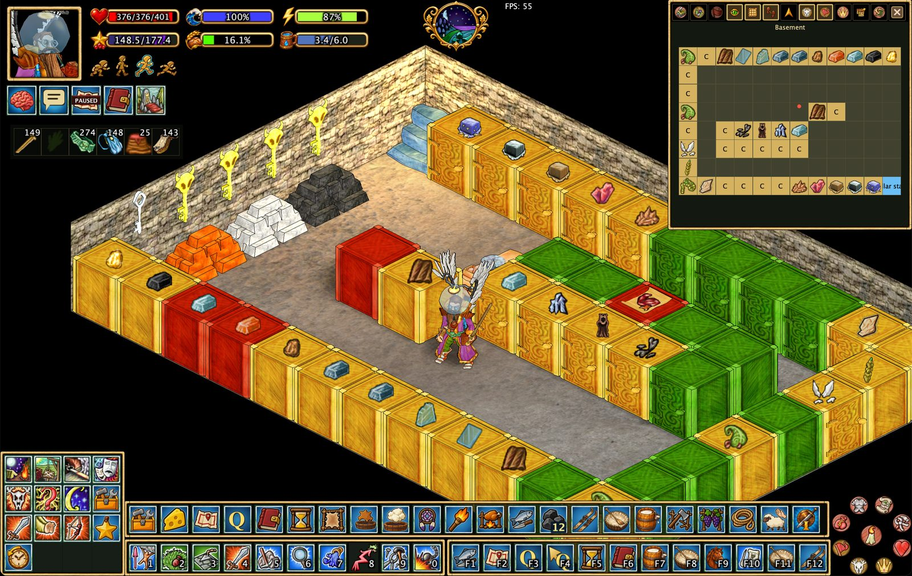

# Hearthborn Client

**A custom client for Haven & Hearth**

*Plan your village. Simplify production. Explore with better tools.*

[Features](#features) · [Screenshots](#screenshots) · [Getting started](#getting-started) · [Documentation](#documentation) · [Support development](#support-development)

Built on top of the original (vanilla) Haven & Hearth client, Hearthborn is an independent, unofficial custom client focused on improving everyday gameplay through a customizable interface and tools for village management, production, exploration, mining, and more.

**Languages:** English and Russian (approximately 98% of the client translated into Russian) · **Technology:** Java 22 / Apache Ant

## Features

Explore each feature in its own illustrated guide.

### 🎛️ Interface & controls

- [**Redesigned interface**](features/interface.en.md) — Classic 4×4 or sidebar menu, movable toolbars, snapping windows, mirrored HUD, and compact mode.
- [**Redesigned Action Search**](features/action-search.en.md) — Favorites, history, recipe details, and ingredient search.

### 🏡 Village & production

- [**Quality Roster**](features/quality-roster.en.md) — Record object quality and display known values on your plans.
- [**Village & Claim Planner**](features/claim-plan.en.md) — Automatically map observed structures, name areas, measure tiles, and export or import plans.
- [**Cheese Production Assistant**](features/cheese.en.md) — Cheese aging stages, rack labels, and progression chart.
- [**Automatic Timers**](features/timers.en.md) — Production, cheese, siege, claim, and manual timers.
- [**Storage & Production Visibility**](features/storage.en.md) — Cupboard contents, stockpile identification, and object labels.
- [**Automation & Xtensions**](features/scripts.en.md) — Helpers for fuel, workstations, crops, animals, and other repetitive tasks.

### 🗺️ Navigation & exploration

- [**Improved Pathfinding**](features/pathfinding.en.md) — On by default, with optional horseback navigation.
- [**Mapping & Exports**](features/mapping.en.md) — Transfer maps between clients or export images and tiles.
- [**Session Trail**](features/session-trail.en.md) — View your route for the current session without recording it.
- [**Map Icons & Display Settings**](features/map-icons.en.md) — More icons, animal sounds, and redesigned map controls.
- [**Meteorite Triangulation**](features/meteorite.en.md) — Narrow a meteorite search area using Star Gaze observations.

### ⛏️ Mining & combat

- [**Reimagined Minesweeper**](features/mining-safety.en.md) — Mark cave tiles, inspect dust clues, and manage mining safety options.
- [**Combat Assistance**](features/combat.en.md) — Animal auto-combat and a compact combat interface.

## Screenshots

A quick look at Hearthborn's interface and tools. Click a feature name for the full guide.

| [Customizable interface](features/interface.en.md) | [Village & claim planning](features/claim-plan.en.md) |
| --- | --- |
|  |  |
| [Quality Roster](features/quality-roster.en.md) | [Map icons & display settings](features/map-icons.en.md) |
|  |  |
| [Cheese production](features/cheese.en.md) | [Automation & Xtensions](features/scripts.en.md) |
|  |  |
| [Cheese aging on racks](features/cheese.en.md) | [Cupboard contents](features/storage.en.md) |
|  |  |

## Getting started

Hearthborn is an unofficial custom client for Haven & Hearth. Installation and launcher instructions will be linked here when a verified distribution is available.

To explore the available features and controls, start with the [interface guide](features/interface.en.md) and [automation guide](features/scripts.en.md).

## Documentation

Detailed guides with screenshots are available in [`docs/features/`](features/). Feature links above lead directly to the relevant pages or sections.

**Note:** Timers, quality information, maps, and automation rely on data actually observed by the client. They do not reveal unexplored information or guarantee successful actions.

## Privacy

Hearthborn is intended to use the standard Haven & Hearth server connection without sending gameplay data to third-party services. This describes the project's intended behavior, not an independently verified network audit. Review the source code and any future integrations before relying on this as a security guarantee.

## Support development

Hearthborn is free for everyone. Donations are voluntary and help support continued development, bug fixes, and new features. They do not unlock exclusive features or provide in-game advantages.

**[❤️ Support Hearthborn on Buy Me a Coffee](https://buymeacoffee.com/hearthborn_client)**

## Credits and license

Hearthborn is an independent project based on the Haven & Hearth client. Original game and client credits belong to their respective authors. Refer to the upstream client for its original license terms.
