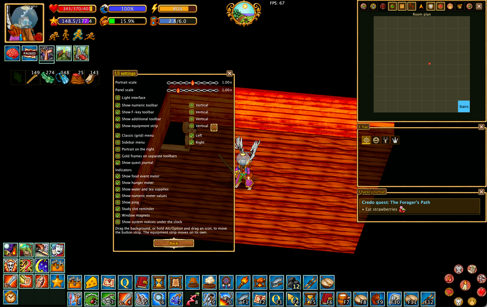
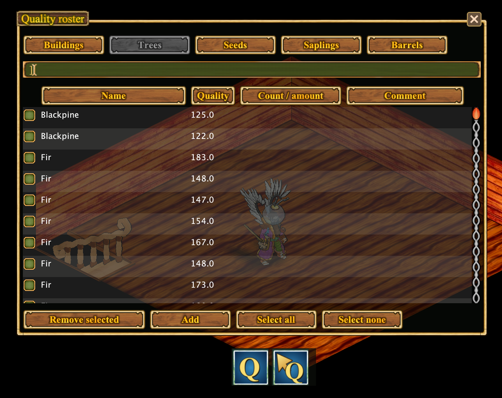
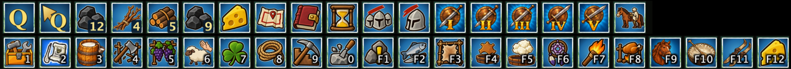

# Hearthborn Client

**Модифицированный клиент для Haven & Hearth**

*Планируйте деревню. Упрощайте производство. Исследуйте мир с удобными инструментами.*

[Возможности](#features) · [Скриншоты](#screenshots) · [Начало работы](#getting-started) · [Документация](#documentation) · [Поддержать проект](#support-development)

Hearthborn — независимый неофициальный клиент на основе оригинального (vanilla) клиента Haven & Hearth. Он предлагает гибкий интерфейс, инструменты для деревни, производства, исследования мира, шахт и боя.

**Языки:** английский и русский (около 98% интерфейса клиента переведено на русский) · **Технологии:** Java 22 / Apache Ant

## Features

### 🎛️ Интерфейс и управление

- [**Настраиваемый интерфейс**](https://jagy2014.github.io/hearthborn-client/ru/features/interface/) — классическое меню 4×4 или боковое меню, панели, закрепление окон и компактный режим.
- [**Поиск действий**](https://jagy2014.github.io/hearthborn-client/ru/features/action-search/) — избранное, история, рецепты и поиск по ингредиентам.

### 🏡 Деревня и производство

- [**Журнал качества**](https://jagy2014.github.io/hearthborn-client/ru/features/quality-roster/) — запись качества объектов и отображение значений на планах.
- [**Планировщик деревни и владений**](https://jagy2014.github.io/hearthborn-client/ru/features/claim-plan/) — карта построек, названия областей, измерения, экспорт и импорт.
- [**Помощник сыровара**](https://jagy2014.github.io/hearthborn-client/ru/features/cheese/) — стадии созревания, подписи и таблица сыров.
- [**Автоматические таймеры**](https://jagy2014.github.io/hearthborn-client/ru/features/timers/) — производство, сыры, осадные сооружения и ручные таймеры.
- [**Хранилища и склады**](https://jagy2014.github.io/hearthborn-client/ru/features/storage/) — значки содержимого шкафов и обозначения материалов.
- [**Автоматизация и Xtensions**](https://jagy2014.github.io/hearthborn-client/ru/features/scripts/) — команды для топлива, производства, животных и растений.

### 🗺️ Навигация и исследование

- [**Поиск пути**](https://jagy2014.github.io/hearthborn-client/ru/features/pathfinding/) — пешком по умолчанию, верхом по отдельной настройке.
- [**Карта и экспорт**](https://jagy2014.github.io/hearthborn-client/ru/features/mapping/) — перенос карт, изображения и отдельные тайлы.
- [**Маршрут сессии**](https://jagy2014.github.io/hearthborn-client/ru/features/session-trail/) — путь, пройденный в текущей сессии.
- [**Значки и настройки карты**](https://jagy2014.github.io/hearthborn-client/ru/features/map-icons/) — новые обозначения и управление отображением.
- [**Поиск метеоритов**](https://jagy2014.github.io/hearthborn-client/ru/features/meteorite/) — определение примерной области по Star Gaze.

### ⛏️ Шахты и бой

- [**Сапёр и безопасность шахт**](https://jagy2014.github.io/hearthborn-client/ru/features/mining-safety/) — отметки клеток, подсказки от пыли и радиусы опор.
- [**Помощь в бою**](https://jagy2014.github.io/hearthborn-client/ru/features/combat/) — начальная автоматизация боя с животными и компактная панель.

## Screenshots

| [Настраиваемый интерфейс](https://jagy2014.github.io/hearthborn-client/ru/features/interface/) | [Планировщик деревни](https://jagy2014.github.io/hearthborn-client/ru/features/claim-plan/) |
| --- | --- |
|  |  |
| [Журнал качества](https://jagy2014.github.io/hearthborn-client/ru/features/quality-roster/) | [Карта](https://jagy2014.github.io/hearthborn-client/ru/features/map-icons/) |
|  |  |
| [Сыроварение](https://jagy2014.github.io/hearthborn-client/ru/features/cheese/) | [Xtensions](https://jagy2014.github.io/hearthborn-client/ru/features/scripts/) |
|  |  |
| [Сырные стеллажи](https://jagy2014.github.io/hearthborn-client/ru/features/cheese/) | [Содержимое шкафов](https://jagy2014.github.io/hearthborn-client/ru/features/storage/) |
|  |  |

## Getting started

Hearthborn — неофициальный клиент Haven & Hearth. Ссылка на проверенную сборку и инструкции по установке будут добавлены после публикации дистрибутива. Начните с [руководства по интерфейсу](https://jagy2014.github.io/hearthborn-client/ru/features/interface/) и [автоматизации](https://jagy2014.github.io/hearthborn-client/ru/features/scripts/).

## Documentation

Все руководства доступны в левом меню. Данные карт, таймеров и качества основаны на том, что действительно наблюдал клиент.

## Privacy

Клиент предназначен для работы через стандартное соединение с игровым сервером Haven & Hearth, без отправки игровых данных сторонним сервисам. Это описание предполагаемого поведения, **не результат независимого сетевого аудита**.

## Support development

Hearthborn бесплатен. Добровольные пожертвования помогают развивать проект и не открывают эксклюзивные игровые преимущества.

**[❤️ Поддержать Hearthborn на Buy Me a Coffee](https://buymeacoffee.com/hearthborn_client)**

## Авторы и лицензия

Hearthborn — независимый проект на основе клиента Haven & Hearth. Права на оригинальную игру и клиент принадлежат их авторам. Условия исходной лицензии смотрите в оригинальном проекте.
